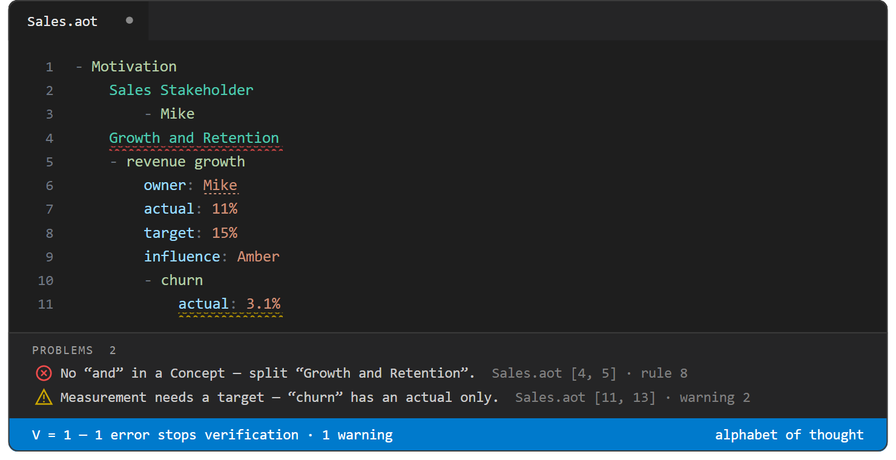

# Alpha (`.aot`)

**Write your thinking as plain text a machine can prove consistent.**

Alpha is the world's smallest knowledge-representation notation: an indented tree of plain text with only four kinds of line. Because the language is that small, its tooling can be an exact referee instead of a guesser — a VS Code extension lints every `.aot` file as you type, checking it against the strongest ideas the history of logic has produced: Aristotle's categories, Leibniz's arithmetic of concepts, Description Logic subsumption, Formal Concept Analysis, Gödel numbering, and Armstrong's dependency axioms. The file is **verified** when its violation total `V` reaches 0.

If your thoughts need to be bigger than one brain can hold at a time — or you just want your ideas to survive contact with an LLM — Alpha gives you a way to write them so that anyone, including you six months from now, can read them instantly and extend them without breaking them.



**Contents:** [Why Alpha](#why-alpha) · [Alpha in sixty seconds](#alpha-in-sixty-seconds) · [Quick start](#quick-start) · [Case study](#case-study-a-quarterly-business-review) · [Language reference](#language-reference) · [Incompleteness is a feature](#incompleteness-is-a-feature) · [Numbering](#numbering) · [The four primitives](#the-four-primitives) · [Starting a model](#starting-a-model) · [Tables](#tables) · [Formulas](#formulas) · [Parking the derivations](#parking-the-derivations) · [Verification: the tooling](#verification-the-tooling) · [Style rules](#style-rules) · [Design principles](#design-principles) · [Using Alpha with an LLM](#using-alpha-with-an-llm) · [Alpha in a team](#alpha-in-a-team) · [Repository layout](#repository-layout)

## Why Alpha

Knowledge work keeps producing the same artefacts — goal trees, domain models, capability maps, process diagrams — and keeps losing them in slides, prose, and diagrams that no tool can check and no two readers interpret the same way. Alpha replaces those with one plain-text format that is simultaneously human-readable, machine-verifiable, and AI-native.

- **Arguments become checkable.** This is the Leibniz point: once "Socrates is an example of Human" is encoded as the divisibility of two integers, an is-example-of claim isn't an opinion — it's a computation the linter either confirms or refutes. `V = 0` means the file contains no structural contradictions.
- **Two readers build the same mental model.** A `.aot` file is a shared definition a team can extend. Nobody maintains a private version in their head.
- **Disagreements become locatable.** When a dispute arises, it is about a specific line — a wrong parent, a missing differentia — not about a vibe in a paragraph.
- **AI can work on it reliably.** Plain text is what language models consume, and the linter is an objective referee: ask an AI to extend or critique your model, then let the linter check the result mechanically instead of re-reading it yourself. The tree gives the AI your actual ontology rather than letting it guess from prose.
- **Your spreadsheets come along.** Every table in a model is mirrored to an ordinary CSV file, so the same knowledge is at once a checked Alpha model and a spreadsheet Excel can open.

Compared with the alternatives: prose hides structure, diagrams don't scale or diff, and formal ontology languages (OWL, UML) demand tooling and training that most teams never adopt. Alpha is four line-kinds and an indent rule — you can teach it in a coffee break and version it in git.

## Alpha in sixty seconds

Yes, the world sometimes feels like a tangled lattice: Socrates is an example of a human, but also a philosopher, and also an Athenian. Alpha's discipline — one parent per idea, relationships modelled as crosslinked ideas of their own — is exactly what makes a file readable at a glance instead of a diagram you need a lie-down after.

```aot
- Alpha Example
    Human
        is alive
        - Socrates
            is alive: No
    Occupation
        - Philosopher    
    City
        - Athens
            resident known as: Athenian
    City of Residence
        human
        city
        - Socrates' Residence
            human: Socrates
            city: Athens
    Employment
        human
        occupation
        - Socrates' Job
            human: Socrates
            occupation: Philosopher
    
```

Read it like this:

- Capitalised lines (`Human`, `City`) are **Concepts** — kinds of thing.
- Lowercase lines (`is alive`, `city`) are **attributes** — properties a Concept has.
- `- ` lines (`- Socrates`, `- Athens`) are **Examples** — concrete individuals.
- `attribute: value` lines (`is alive: No`) give an attribute a concrete **value**.
- `human: Socrates` is a **crosslink**: the value names an Example defined elsewhere, and the extension underlines it — Ctrl+click jumps to the definition. Socrates has exactly one parent (`Human`), yet participates in residence and employment through Concepts of their own. Single inheritance for what a thing *is*; crosslinks for what it *relates to*.

## Quick start

1. **Install the extension.** Download the newest `alphabet-of-thought-*.vsix` — from [Releases](https://github.com/Jakus23/alphabet-of-thought/releases) or the copy at the root of this repository — and run `code --install-extension <the .vsix>`. Or build the current source in one step with `python install.py`, which packages, installs, and tells you to reload the window. (The extension is not yet on the VS Code Marketplace.) You get syntax colouring, the linter, crosslinks, and the table editor.
2. **Create a file.** Name it after the subject: `Human.aot`, `Sales.aot`. The **file name is the root Concept** — do not repeat it as the first line; the file's top-level lines are already its children.
3. **Pick a real subject.** Take something you currently explain badly in a document — your team's metrics, a domain model, a process with a known bottleneck — and pick the matching [primitive](#the-four-primitives) as a skeleton.
4. **Write indented plain text using only four kinds of line** (see the [language reference](#language-reference)). Start with natural Concepts and build up from facts, or normalise an existing data structure and derive relations from it. Either way, the move is the same: generate the facts first, then branch out.
5. **Fix squiggles until `V = 0`.** The places where you can't decide on a parent are the places where you didn't actually know what you meant — which is the point. (The same check runs from the terminal: `node verify.js <file.aot>`.)
6. **Ask an AI to explain what you wrote.** Paste the file into an LLM and ask for an explanation. You'll be amazed at what you learn about something you thought you knew. (See [Using Alpha with an LLM](#using-alpha-with-an-llm).)

## Case study: a quarterly business review

Here is the artefact knowledge work produces most often — a status slide:

> **Q2 Sales: Growth and Retention.** Revenue growth on track (11%). New-client pipeline healthy. Basket size up. Churn improving. Owner: Mike.

Fifteen minutes of Alpha later, the same claim is `Sales.aot`, written with the [Motivation primitive](#motivation):

```aot
- Motivation
    measurement interval: quarterly
    Mike
        role: Head of Sales
        - revenue growth
            actual: 11%
            target: 15%
            influence: Amber
            - new client count
                actual: 46
                target: 60
                influence: Red
            - average basket size
                actual: $2,510
                target: $2,400
                influence: Green
            - churn
                actual: 3.1%
                influence: Amber
```

What the linter caught before the meeting could:

1. **"Growth and Retention" is two kinds.** The first draft filed the measurements under a `Growth and Retention` Concept, and it squiggled red on the spot (error 8, no "and" in a Concept). Growth and retention have different levers and different measurements; the model forces the split the slide fudged.
2. **"Churn improving" had no definition of good.** `churn` carries an `actual:` but no `target:` (warning 2). The yellow squiggle is the question *"improving relative to what?"* asked mechanically, before anyone has to ask it out loud.
3. **"On track" contradicted its own children.** 11% against a target of 15%, with the leading driver Red — visible at a glance once every measurement is forced to carry `actual`, `target`, and `influence` side by side. No linter rule fired here; the notation itself removed the room to hide.

The file ends in the honest state: structure verified, one warning left on `churn` — an open question the team must answer, not a formatting task. And the review doesn't die in a deck: next quarter extends the same tree, `owner: Mike` still crosslinks to the same `- Mike`, and git shows exactly which line changed and who changed it.

## Language reference

### File format

- Extension: `.aot`
- Indentation: exactly 4 spaces per level. Tabs are forbidden.
- Every non-blank line is a node in the tree. A line's parent is the nearest line above it that is indented one level less.
- The **file name is the root Concept**. `Human.aot` begins directly with `full name`, `age`, and so on — never with a `Human` line.

### One parent per idea: the parent–child chain

Every idea in Alpha has exactly one parent. A parent may have many children; a child never has two parents. The chain runs from the general (the file name) to the specific, until it terminates. An idea never means something different depending on which path you took to reach it.

The restriction is deliberate. The parent–child chain **is a type system** — not *like* one. Each Concept is a type, each sub-Concept a subtype, each Example a value inhabiting it, and the linter checks membership by divisibility of the characteristic numbers exactly as a type checker checks a term against its type. Because the primitives are this precise, you are not limited to Alpha's own taxonomy: you can literally build the type system you want — a programming language's, a taxonomy's, a schema's — as a tree in Alpha and have it mechanically checked. One parent per idea forces you to decide what an idea *is* before you can write it down, and that explicit commitment is one other people can share: everyone who opens the file extends the same tree instead of rebuilding a private version in their head. What a thing relates to, as opposed to what it *is*, is modelled with [crosslinks](#crosslinks).

### The four kinds of ideas

Alpha agrees with Aristotle that everything you can think falls into four categories (*Categories* 2, 1a20–24), produced by crossing **said-of** (universal vs. individual) with **present-in** (substance vs. accident):

| Kind | Aristotle's name | How to recognise it | Said of (S) | Present in (P) | Example |
|------|------------------|---------------------|-------------|----------------|---------|
| **Concept** | Universal Substance | First letter capitalised | S | ~P | `Human` |
| **Example** | Individual Substance | `- ` (dash + space) prefix, or the value in a capitalised `Concept: value` line | ~S | ~P | `- Socrates` |
| **Attribute** | Universal Accident | All lowercase | S | P | `is alive` |
| **Attribute Value** | Individual Accident | The value after the colon in a lowercase `attribute: value` line | ~S | P | `is alive: No` |

#### Concept — a kind of thing

A Concept defines a class or type of idea. Indenting one Concept under another asserts the child **is a kind of** the parent — a sub-Concept is always an *is-a*, never a *has-a*.

- A Concept name may recur elsewhere only when a distinguishing qualifier prefix makes it unique (see [Univocity](#errors--red-squiggle-counted-in-v-the-file-does-not-verify), rule 9).
- Never put "and" in a Concept name — that is two kinds under one name. Split it into two sibling Concepts.
- Start two levels of granularity above the detail you need, then prune until every leaf is directly useful. Remove anything that does not serve the model.
- Prioritise Concepts by relevance; keep the Concept tree lean.

```aot
Mammal
    Human
```

#### Example — a concrete individual

An Example names a real, concrete instance of its parent — something you could point at, meet, or look up. Model data as sets of Examples.

```aot
Human
    - Socrates
```

**Inline Examples.** A capitalised `Concept: value` line is the same idea written as shorthand: the capitalised term stays an ordinary Concept, and `value` is one Example of it — exactly what a `- value` child would be — written inline as a convenient first Example.

- The inheritance runs **Concept → Example**, just as with a dashed child: the inline Example inherits **all** of the Concept's attributes and their default values.
- The value (for instance `code --install` in `Run Command: code --install …`) is the Example's own identity; everything the Concept defines accrues to that Example instance.
- Further Examples may follow as ordinary `- ` children below it, and the Concept may still divide into sub-Concepts, each with Examples of its own. The inline value is simply one Example among however many the Concept comes to have.

#### Attribute — a property a Concept has

An attribute is a lowercase line defining a property its parent **has**. Attributes describe; they never classify.

- Every attribute is itself a Concept that can be expanded elsewhere, whether or not it is defined elsewhere (see [Crosslinks](#crosslinks)).
- Non-nullable attributes are listed first; attribute order is otherwise meaningless.
- Attributes are not necessarily leaf nodes: an attribute may have its own children — Examples, Concepts, values, or further attributes.
- Remove attributes that do not serve the model.

```aot
Human
    is alive
```

#### Attribute Value — the concrete value an attribute takes

An `attribute: value` line is **two** ideas, not one: the attribute (`colour`) — a universal accident the Concept has — and the individual value (`red`) that descends from it, written on one line.

- The inheritance runs **Concept/Example → attribute → value**: the value descends from its attribute, and the attribute from the idea that carries it.
- The value never descends from the Example directly, and the attribute name is not part of the value's name. The attribute and its value merely share a line.

```aot
- Socrates
    is alive: No
```

### Classifying correctly: four tests

A model only communicates when its ideas are classified correctly (Concept vs. Example vs. attribute). Apply these tests in order:

1. **Unity test (Concept vs. Example).** If the children together **partition** the parent — every child is a subtype, no two overlap, nothing of the parent is left over — they are **Concepts** (subtypes). If the children are merely a selection of items drawn from the world, they are **Examples**.
2. **Abstraction test (Concept vs. Example).** Concepts are abstract groupings humans invent to organise thinking; Examples are concrete instances you could point at or name. When in doubt: has someone defined a grouping? → Concept. Could you meet it, touch it, or look it up? → Example.
3. **Attributes describe, they don't classify.** If a lowercase line is telling you *what kind* the parent is, it is a misfiled Concept. If a capitalised line is telling you a property the parent *has*, it is a misfiled attribute.
4. **Rigidity subtype test**: Must every instance always be this? a Person is always a Person; a Manager isn't always a Manager, so it is not a kind of Person

### Attribute inheritance

Attributes defined on a Concept are inherited by every child Concept and Example. The rules in one snippet:

```aot
Parent
    essential parent attribute: normal value
    Child
        essential child attribute not in parent
        - Child Example
            essential parent attribute: new value
            essential child attribute not in parent: value
            child example attribute
        ... generally there is more than one example per Concept
    ... generally there is more than one child per parent
```

`Child` inherits `essential parent attribute: normal value` from `Parent`. `- Child Example` **overrides** that inherited value with `new value`, assigns a value to `essential child attribute not in parent`, and adds `child example attribute` — an accidental attribute not present on the `Child` Concept. The two `...` lines mark the model as deliberately incomplete, which is the only thing a Map does.

### Concepts across files

One subject per file is the rule, but a person, a system or a measure worth modelling turns up in more than one subject. When the same Concept is written in two files, Alpha reads the two halves logic already gives it and treats them differently:

| | What it is | Across files |
|---|---|---|
| **Intension** | the definition: the attributes and values it declares, and the kind it is filed under | **must agree** — and the editor makes it agree on save. |
| **Extension** | the Examples it lists — the individuals it vouches for | **is a partial sample.** The repo-wide truth is the union, and differences are never a conflict. |

Every occurrence is a **peer**. No file owns a Concept, and none is exempt from saying it is partial. Two files each listing the motivations their own subject needs are not in conflict at all:

```aot
monthly close.aot                          bank recon.aot
- Motivation                               - Motivation
    Jakus                                      Jakus
        role: financial controller                 role: financial controller
        - Do Monthly Processing                    - All Transactions Are Reconciled
        ... 4 more in bank recon.aot:2             - Transactions Are Reconciled Correctly
                                                   - Incorrectly Reconciled Transactions ...
                                                   - Future Transactions Are Reconciled ...
                                                   ... 1 more in monthly close.aot:2
```

**Saving a file makes that file agree with the repo**, as far as agreement can be reached without a human deciding anything. It is additive: nothing you wrote is ever deleted, and no other file is touched — saving `monthly close.aot` writes to `monthly close.aot` and nothing else, so peers converge as you save each of them.

| Difference | On save |
|---|---|
| A peer declares an attribute or value this occurrence does not have in force | **written in.** `role: financial controller` above was declared in one file and appears in both. An attribute a peer merely *inherits* is already in force here too, and is not copied. |
| A same-named Example is given an attribute here that it lacks there | **written in** — an Example has an intension too, and the same rule settles it. |
| The Example lists differ | **one `...` line, kept true** (below). The Examples themselves stay where they are. |
| One attribute carries two values | **left alone, an error on every side.** Only you know which is right; the lightbulb offers *Set '`attr`' to '`value`' everywhere*. |
| One Concept is filed under two kinds | **left alone, an error on every side.** Moving a Concept between kinds is a modelling decision. |

**One side saying less is never disagreement.** A file silent about `role` does not contradict one that sets it — it simply says less, and the save fills the rest in.

#### The `...` line

Because the attributes are written into every file and a surviving disagreement is an error with its own squiggle, the `...` carries the one thing that cannot be filled in: how many Examples live elsewhere, and where.

```aot
... 4 more in bank recon.aot:14
... 7 more in bank recon.aot:14, payroll.aot:9
... 11 more in bank recon.aot:14, payroll.aot:9, vat return.aot:22, …
```

The total comes first, then `file:line` locations — Ctrl+click any of them to open that file at that Concept, and hover the line for the whole extension, every Example a link to where it is actually written. Past three peer files the line stops growing and the rest moves to the hover.

A `...` line **you** wrote is never touched: only the maintained shape (`N more in …`) is rewritten, so `... still to do` sits beside it untouched. Turn the whole thing off with `aot.autoReconcile`, and the drift is reported as a warning instead of being closed for you. Files that were never open when a peer changed catch up with **AOT: Reconcile Concepts Across Files**, or `node verify.js --workspace --reconcile`.

**A Concept written as a table carries its `...` one level under the grid.** A table's first header cell *is* the Concept, so one level under the grid is one level under the Concept — where its children belong — and a `...` written there is read as **the table's own**, never as a note about the row it happens to follow:

```aot
Employee|role     |department
Alice   |Developer|Engineering
Dave    |Writer   |Marketing
    ... 4 more in team roster.aot:12
```

That is the only place a table has for a Map, and it is why the note is found again on the next save and kept true rather than written a second time. (A *row* that needs a `...` of its own is written in line form, where it has a line to hang one under.) Everything else applies to a table either way: attributes a peer declares arrive as new columns, and a row gains the values its Example was given elsewhere.

### Aliases and Maps

Alpha is **not a word-explanation language**: a definition terminates in Examples and data, never in words explaining other words — a dictionary chain of synonyms proves nothing and checks nothing. What *is* possible is renaming: an alias gives the same idea a second name without pretending to define it.

| Notation | Syntax | Purpose |
|----------|--------|---------|
| **Alias** (has-another-name) | Parentheses after a term: `Human (Natural Person)` | Provides an alternative or derived name for an idea. If some or all of an attribute's trailing words match a Concept, those words already act as an alias — no parentheses required. |
| **Map** | An indented `...` line, optionally followed by a note: `... todo: list the remaining operations` | Marks **only** what is intentionally omitted, still a todo, or held at low confidence — **never** a plain description of the line above it. To explain or rename a term, use an alias instead. A Map excuses its parent from the completeness checks (see [Verification](#verification-the-tooling)). One shape, `... N more in file.aot:12`, is [maintained for you](#concepts-across-files) and says where the rest of a Concept's Examples live; every other Map is yours alone. |

### Incompleteness is a feature

No model is ever finished, and Alpha is built so that an unfinished one still **verifies**. `V = 0` is not a claim that everything is written down — it is the claim that **nothing written down contradicts anything else**. Consistency is the property a machine can check; completeness is not, and a notation that demanded both would be unusable on the first day of any real subject.

That is a deliberate choice, and it is the oldest result in the toolbox. Gödel (1931) showed that a system rich enough to say interesting things cannot be both complete and consistent. Alpha keeps consistency and hands completeness back to you as something you *declare* rather than something you are *caught* lacking. The [Gödel numbers](#gödel-numbering) say the same thing arithmetically: exponent **0** means the attribute is simply absent. Silence is representable. A half-described idea is a well-formed number, not an error.

Four places in the language make this concrete:

| Where | What it means |
|---|---|
| **The `...` Map** | The one line whose whole job is to say *there is more here*. It marks what is intentionally omitted, still a todo, or held at low confidence — and it **excuses its parent** from the completeness checks: a lone sub-Concept, a Concept that would otherwise look like it had drifted from its kind. Missing is not the same as forgotten, and the `...` is how you tell the difference. |
| **Extension is a partial sample** | A Concept's Examples are never claimed to be all of them. Two files listing different Examples of one Concept are both right, the repo-wide truth is the [union](#concepts-across-files), and the `... N more in bank recon.aot:14` line is maintained for you rather than reported against you. |
| **Advisory findings never count in `V`** | Spelling hints, Example hints, FCA suggestions, dependency findings — everything that says *you might be missing something* is a hint or a warning, never an error. Only the file's own contradictions reach `V`. |
| **Attributes are optional by default** | An attribute declared on a Concept and left unvalued on an Example is `present but unvalued`, a first-class state (exponent 1), not a hole to be filled before the file will pass. |

What incompleteness never excuses is **contradiction**. One attribute carrying two values, one Concept filed under two kinds, an `and` in a Concept name, a dependency cycle — those are errors wherever they appear, `...` or no `...`, because they are not gaps. A gap is a place you have not been yet; a contradiction is a place that cannot exist.

The practical consequence is the working style Alpha is built for: **write the part you know, mark the part you don't, and keep the file green the whole way**. A model that had to be finished before it was correct would never be started.

### Numbering

Lists and taxonomies often want visible order, so Alpha maintains it for you — on **save** and on **Format Document**, never mid-keystroke:

- **Examples.** Give any Example an `N. ` prefix (`- 1. Mix`) and all of that Concept's Examples number sequentially in listed order — unnumbered names gain a number, stale numbers correct — and every same-file reference to a renamed Example (crosslink values, table name cells, formula references) follows, exactly as F2 would rename it. A list with no numbered Example is never touched.
- **Concepts.** Type `1. ` on any Concept and every Concept in its scope numbers in document order — top Concepts `1. `, `2. `, sub-Concepts dotted down the is-a chain (`1.1`, `1.1.1`). The scope is the whole file normally; a Concept filed under an Example or attribute numbers only that parent's Concepts. A fully numbered scope keeps its numbers true to position, so moving a Concept and saving corrects them.
- **The way out is one deletion.** Delete any one Concept's number and the whole scope's numbering comes off on the next save, parents included. (A new unnumbered Concept in a numbered scope reads the same as a deletion and switches numbering off; retype `1. ` on the top Concept to bring it back.)
- **Numbers are presentation, never identity.** Name resolution strips the prefix everywhere, so an attribute `trip` still types by the Concept `1. Trip`, `@Trip@column` still resolves, and `2. Animal` beside `Animal` is still a univocity error. Numbering — or un-numbering — a tree breaks no reference and rewrites none. A number without its dot is never a prefix: `- 35` and `3 Body Problem` keep their names whole.

See [`examples/numbering.aot`](examples/numbering.aot) for a file to try it on.

### Crosslinks

Single inheritance answers what an idea *is*; crosslinks answer what it *refers to*. The extension (`src/crosslinks.js`) underlines three inline connections, resolves them for go-to-definition (Ctrl+click jumps; hover shows the target and its line), and carries a referenced node's ancestry into the FCA audit. Resolution is **repo-wide**: a reference whose target lives in another `.aot` in the workspace links to it, and Ctrl+click opens that file (the local file wins ties). Link kinds are told apart by underline style, not colour — the link keeps its token's syntax colour:

| Connection | What links | Underline | Example |
|------------|-----------|-----------|---------|
| **attribute-is-a-Concept** | An attribute or value whose **trailing** words name a Concept (case-insensitive); the longest trailing run wins. When the attribute carries a `(alias)`, the alias is the **only** link — the trailing-name run is suppressed. | solid | `age integer: 5` → the `Integer` Concept; `duration (time)` → `Time`, never `Duration` |
| **concept-contains-Concept** | A Concept whose name contains a run of words naming another Concept (case-insensitive); each longest, non-overlapping run links, but the whole name never does. | solid | `Independent Node` → the `Node` Concept |
| **value-is-an-Example** | A value that matches an Example name (case-insensitive, like every link). | dotted | `human: Socrates` → `- Socrates` |

#### Composition

Attributes are sometimes atomic values, but Alpha also allows an attribute to be defined as a Concept somewhere else. An `Employee` can be composed of a `human`, a `contract`, and a `role` attribute, each of which sits in its own parent–child chain and is independently inherited as an attribute of the `Employee` Concept. Crosslink composition is how you assemble a complex idea from parts that each have their own definition; inheritance is how you say what kind of thing the idea is.

#### Attribute alias

A relational attribute referencing another Concept uses that Concept's name, written lowercase: an attribute `human` on `City of Residence` links to the `Human` Concept automatically.

#### Concept differentia

A Concept such as `Employee` may be used inside another Concept's name — for example `Train Employee`. The two Concepts are distinct and unambiguous, yet it is the same idea of `Employee` that is evoked in the writer's and reader's mind for both. Alpha celebrates this: the containment crosslink records that `Employee` was defined elsewhere.

Every attribute the child adds must be a **differentia** — a fact that makes it a *narrower kind of the same genus*, answering "what kind of the parent is this?". A child may carry more attributes than its parent; what matters is not how many it adds but that they narrow the *same* kind. If the added facts instead describe a separate dimension the thing merely *has* — a format, a property on its own axis — then you have written a has-a as an is-a: the Concept now names two kinds at once, and the subsumption reasoner flags it (rule 12, Multiple kinds). Pull that has-a out into its own attribute or Concept and crosslink it, so the child's place in the tree stays purely about what it *is*.

#### Values against their Concept

When an attribute names a Concept and that Concept **lists its Examples**, the attribute's values are answerable to that list. Typing such a value pops a **dropdown of the Concept's Examples** — on a line-form value and in a typed column's table cell alike, archived CSV values listed after the live ones. `person: James`, on an attribute typed by a `Person` whose only Example is Socrates, says James is a Person while the file never says who James is. Alpha hints the value and offers the Quick Fix that closes the gap — **Add 'James' as an Example of 'Person'** — which lists James where Person is already written: a row on its table, or a `- James` line under its last Example, cursor left on the new Example so you can carry straight on. Picking from the dropdown and coining a fresh Example both keep the model whole.

```
Person  |nationality
Socrates|RSA
Integer
    - 1
    - 35
Measurement
    person: James        <- hinted: not an Example of Person (Socrates)
    age integer: 5       <- hinted: not an Example of Integer (1, 35)
```

This is a **gap in the model, not a contradiction in it**, so it hints exactly as spelling does — on its own span and on hover, never in the Problems panel, never in `V` — and turns off with `aot.exampleHints`. An attribute may mention a Concept without being valued by one, so three things keep the hint to values that were genuinely trying to name an Example:

- **The Concept must list Examples.** One that lists none states an open vocabulary, where any value is fair — `name: Socrates` is prose, not a claim against a listed set.
- **The value must be the same kind of value its Examples are.** `maximum worker pool: 1` measures the pool; it does not name one of Role/Asset/Function, and a number never could. `age integer: 5` *is* a number among the numbers 1 and 35, so it genuinely misses.
- **The value must not be a truth value.** `present in: False` says a fact holds; it does not nominate an Example.

## The four primitives

Alpha is aimed at knowledge workers — analysts, architects, anyone whose job is to think in structures. You can use it purely for your own thoughts, but Alpha ships four primitives for the four kinds of model knowledge work keeps producing anyway, usually scattered across slides and spreadsheets. They are built on Aristotle's four causes — his complete answer to *why a thing is and how it comes to be* (*Physics* II.3, 194b17–20) — combined with the *Categories*, the *Prior Analytics*, and Kipling's six serving-men. **The four causes complete every explanation**: final (motivation), material (graph), formal (function), efficient (workflow).

| Cause | Aristotle's phrase | Native question | Primitive | Said of | Not said of |
|-------|--------------------|-----------------|-----------|---------|-------------|
| **Final** | for the sake of which | Why, and for whom | **Motivation** | Party (Who) | Measurement (How much) |
| **Material** | that out of which | made of What | **Graph** | Entity (Where: the boundary that fixes where the record resides in reality) | Record (What) |
| **Formal** | the form, the arrangement of parts | What it is, How it is achieved | **Function** | Objective (How) | Class (Which) |
| **Efficient** | the agent and the means | by Whom, in what order | **Workflow** | Worker (Agent) | Time (When) |

Each primitive's names are always modelled as Examples (not said of, not present in). The "Said of" column names the only Concepts allowed inside that primitive — Stakeholders, Entities, Objectives, and Worker Pools can never be Examples or Attribute Values, while measurements, records, classes, and times can only be Examples or Attribute Values.

The primitives can — and are encouraged to — link to one another: a Motivation's measurement may name a Workflow's worker, a Graph's entity may type a Function's argument, and every such crosslink makes the model more connected and more checkable. What no primitive may do is *terminate* in another: each remains a complete tree of its own, its cause fully answered in its own terms, never reduced to a pointer into its neighbour. A complete explanation holds all four in balance — linked freely, each still standing on its own.

See [`examples/thought.aot`](examples/thought.aot) for one subject — thinking itself — modelled through all four primitives.

### The model is unbalanced until all four are used

The four causes are Aristotle's *complete* answer to why a thing is: drop one and the explanation is not merely shorter, it is **lopsided**. The missing cause's work does not disappear — it is smuggled into the primitives that remain, where it reads as noise, and the model quietly starts answering a question nobody asked.

| Missing primitive | How the imbalance shows |
|---|---|
| **Motivation** | Objectives with no *why* above them and measurements with no one who benefits. The tree grows detail nobody can prioritise, because nothing says what it is worth. |
| **Graph** | Records masquerading as Concepts. Attributes multiply on ideas that should have been Examples of an entity, and the same fact ends up written in three places with nothing to reconcile it. |
| **Function** | The *how* hides inside workflow steps: the order of work stands in for the arrangement of work, so you cannot tell which capability a step realises, or what would break if it were removed. |
| **Workflow** | Everything reads as simultaneous and unowned. No agent, no order, no contention — so no bottleneck is visible and no schedule can be derived. |

A file using one primitive can still reach `V = 0`. That is not a loophole: consistency is what the linter checks, and coverage is [something you declare, not something you are caught lacking](#incompleteness-is-a-feature). **Balance is the reader's check, not the linter's** — and it is the one worth making a habit. If you cannot produce all four for a subject, you do not yet understand it; the primitive you cannot write is exactly the part you have been assuming.

The counsel of perfection is not "finish all four before you write anything". It is: start where the knowledge is, and treat each primitive you have not reached yet as a `...` — a declared gap, in the model and in your understanding of the subject alike.

### Motivation

Focus: **what is measured, why, and who benefits from it.**

The Motivation primitive describes what you are trying to achieve and who owns it: goals and KPIs with a beneficiary, an `actual`, a `target`, and a Red/Amber/Green `influence` rolling up the tree. This is an OKR tree or a metrics dashboard as text — exactly what a quarterly business review tries to communicate — with every measurement recording its owner.

Every measurement carries both a `target` value and an `actual` value. Alpha requires both because a measurement only means something when you can compare the actual against the target (the linter warns when either is missing).

### Graph

Focus: **what the system is made of.**

Data modelling: which entities exist, where records reside, and what depends on what. The Graph primitive even encodes normalisation reasoning (Armstrong's axioms) as tree shapes, so you can use it to design a schema before touching a database — the linter's [dependency inference](#armstrongs-axioms-dependency-inference) tells you when a column is derivable.

### Function

Focus: **how the system does it**, decomposed as a tree of capabilities.

Capability decomposition: what the system achieves, as a tree of verb-phrase objectives where each parent is achieved exactly by all its children together. A value-chain model is an organisation's capability map; the naming rules below force each node to be one testable claim.

The questions in a Function tree run in different directions. Ask **How** downward: a parent objective is achieved exclusively through all of its children together — no single child is the how; the complete set is, and that arrangement is the parent's form (*Metaphysics* Z: the form of a house is the arrangement of its bricks, not the bricks). Ask **Why** upward: the answer to a child objective's why is its parent; the root is one or more objectives that cannot be reduced further, their why balanced by the whole tree beneath them. Ask **Which** of an objective to reach a Class. Alpha follows Aristotle in taking the form of a working thing to be its function: an axe that cannot chop is an axe in name only (*De Anima* II.1). The Function tree *is the form of the Motivation* — the arrangement that realises it.

**Naming rules**

- **Objective**: verb + qualified object → `Calculate Payment`. One verb per objective, named objectively.
- **Types**: nouns only, expressed as Examples → `- Payment Type`.

**Forbidden in Function names**

- Vague service verbs: "manage", "ensure"
- Performance terms: "good", "acceptable"
- Information-management words: "information", "data", "content", "info"
- Political words: "Business", "IT", "Management", "Support", "Execution"
- Flow words: "then", "next"

**Decomposition rules**

- 3 to 7 sub-objectives per parent objective.
- Test each split with the **Why**, **How**, and **Which** questions above.
- Attributes may be attached to objectives to describe their arguments and results.

### Workflow

Focus: **who acts, in what order.**

Who works on what, in what order, including concurrency: locks, queues, race conditions, and where the bottleneck is. [`examples/thought.aot`](examples/thought.aot) models intuition versus deliberation this way — deliberation is the synchronous bottleneck that waits on a condition, holds working memory, and loses races to bias.

## Starting a model

There are two ways in, and they meet in the middle:

- **Normalise an existing structure.** Take a schema, a spreadsheet, or a document you already have, file its rows as Examples, and derive the Concepts and attributes from what the data bears out.
- **Start axiomatically.** A flat list of Examples: file every Example directly under the file-name root. This is the [content-over-structure](#pragmatic) rule taken to its limit, and the inverse of normalising. There is no hard part to an axiomatic start, because thinking is never complete — any checklist of the questions a subject must answer will do. Four good ones, in order of sophistication:
  - **Your todo list.** Each open item is an Example the model is missing; emptying the list and completing the model are the same act.
  - **Kipling's six serving-men.** *What, Why, When, How, Where, Who* ("I keep six honest serving-men; they taught me all I knew"). Six Examples to start with.
  - **Aristotle's ten categories.** Substance, quantity, quality, relation, place, time, position, having, action, being-acted-upon (*Categories* 4). The widest net for *what can be said of a thing*: each category is one more attribute to ask after.
  - **The Alpha primitives.** Motivation, Graph, Function, Workflow. All real knowledge straddles all four; if you cannot produce them all, you do not yet fully understand the subject.

Whichever you use, the move is the same: generate the facts first, then branch out from there.

## Tables

Alpha recreates org-mode's plain-text spreadsheet: a pipe table the linter reads as ordinary Examples, so an axiomatic start can be written as the grid it already is. **The pipe divides, it never borders** — one between each pair of cells and none at either end, so a table is exactly as wide as its content and its first column starts where every other line of the language starts. (One table has no pair of cells to divide — a Concept with **no attributes**, one column of names and nothing else — and there the pipe *closes* the row instead, `Alice|`, which is what keeps such a table a table rather than plain outline lines.) **The first header cell names the Concept the table describes** — the table stands exactly where that Concept's own line would, with no separate heading above it and no extra indent:

```aot
Order           |country|currency|basket size
Acme March Order|France |EUR     |$1,200
Bolt March Order|Germany|EUR     |$3,100
Kite March Order|Japan  |JPY     |$780
```

- The header row's **first cell names the Concept** — capitalised, like any Concept — and the cells after it declare the columns as **attributes** of that Concept, exactly as bare lowercase lines would. So a capitalised column, or a lowercase first cell, is an error. *(Before 1.9 the table was indented beneath a separate `Concept` line and its first cell was a `name` label; that label is gone — write the Concept's name in its place.)*
- **A Concept can still carry line-form facts beside its grid.** Give the Concept its own line and repeat its name in the first header cell: the table then *fills that Concept in* rather than declaring a twin, so its default values, its `- ` Examples, and the grid's rows all belong to the one Concept — and a cell formula reads the line-form defaults by name (`=@price*@tax rate`):

  ```aot
  Order
      tax rate: 0.2
      - Loose
          price: 50
      Order|price|vat
      Acme |100  |20 =@price*@tax rate
  ```
- **The header is the row that stands first.** Nothing declares it: the first row of a table names the Concept and its columns, and every row under it is an Example. (Before 1.12 a `---+---` rule under the header said so. It said nothing the order did not, and drew a line no reader needed; a rule left in an older file is skipped, and the next re-draw takes it out.) So a table being typed is never wrong yet — one row is a header with its rows still to come.
- Every data row is an **Example** named by its first cell — filed under the Concept the header names — and every further cell is that Example's **Attribute Value** for its column. An empty cell asserts nothing. A row with more cells than the header names, and an empty name cell, are both errors.
- **A row nests under the row above it, and that is an Example hierarchy.** A row indented one level deeper than the row before it is that row's **sub-Example** — exactly what `- Child` under `- Parent` says in free text — so a grid can hold a tree and not only a list. The depth is the line's own indent, four spaces to the level, the same way the whole language writes depth; a row's cells are its own, and a child inherits none of its parent's (an empty cell asserts nothing, here as everywhere):

  ```aot
  Thing       |age
  Parent      |
      Child 1 |10
      Child 2 |12
  Other Parent|
      Child 3 |7
  ```

  The header is the one row that cannot nest — it names the Concept the whole table describes — so the first data row is always top-level, and a row cannot skip a level any more than a line can. Anything under one level is **gutter**, not depth, so a pasted `Otter | size` still reads as one flat row.
- **One pipe is what makes a row.** A blank line, or any line carrying no `|`, ends the table; a row written *deeper* than the header nests inside it rather than ending it. A literal pipe inside a value is written `¦`, the broken bar the CSV mirror already bends it to. **Two standalone tables in a row need a blank line between them**, or the second's header reads as more data rows of the first.
- **Format Document** (`Shift+Alt+F`) re-aligns every table as org's `TAB` does: each column padded to its widest cell. Columns carry **no gutter spaces** around the pipes — a file's width is precious — but stay vertically aligned. A row ends at its last written cell, since padding past it is only trailing whitespace: a row that stops short keeps the dividers of the empty cells it stops before, and a row whose *name* cell is empty — one still being filled — opens with the spaces of that cell, so the columns below still line up. A table with no attributes has no divider to draw, so its rows close with the pipe instead (`Org Structure|` over `Department A |`), and that pipe reads back as the empty last cell it looks like — which is why re-drawing it changes nothing.
- **One row is one line, and a cell is never broken to fit.** A column is as wide as its widest cell, however long that is. *(Between 1.8 and 1.12 a header cell could carry a width cookie — `description <24>` — capping its column and wrapping longer values onto continuation rows. It is gone: a cookie bought a narrow table at the price of the plainest rule the language has, and `<24>` is now nothing but part of a column's name.)*

### The table editor

Org's table automations are built in. While the cursor is on a table row — any line carrying a divider — the extension takes over these keys; every one of them re-aligns the whole table first, so a table never needs manual spacing:

| Key | What it does |
|-----|--------------|
| `Tab` | Re-align, then jump to the next field; at the table's last field a new empty row is appended |
| `Shift+Tab` | Previous field, wrapping to the row above |
| `Enter` | Same column, next row; appends a row at the bottom (`Shift+Enter` still inserts a plain newline to leave the table) |
| `Alt+←` / `Alt+→` | Move the cursor's column left / right, header and all |
| `Alt+↑` / `Alt+↓` | Move the cursor's row up / down |
| `Alt+Shift+→` | Insert an empty column where the cursor stands |
| `Alt+Shift+←` | Delete the cursor's column |
| `Alt+Shift+↓` | Insert an empty row above the cursor's |
| `Alt+Shift+↑` | Delete the cursor's row |
| `Ctrl+Alt+↑` / `Ctrl+Alt+↓` | **Copy** the cursor's whole row above / below it — the next Example is usually the last one with two fields changed |
| `Ctrl+Alt+←` / `Ctrl+Alt+→` | **Copy** the cursor's whole column to its left / right, header and every value |
| `Ctrl+Alt+Shift+` arrow | **Copy the cell** into its neighbour in that direction and follow it there, so holding the key fills a run |
| `Tab` / `Shift+Tab` **with lines selected** | Indent / unindent the selected lines, exactly as anywhere else in the editor — which is how a row is **nested** under the row above it, since a row's depth *is* its leading spaces, and how a whole table is re-filed under a different parent |
| `Ctrl+Alt+T` | Write the Concept at the cursor out as free text, and the same key writes it back as a table — see [Flipping between a table and free text](#flipping-between-a-table-and-free-text) |

**`Tab` never moves the data.** Inside a table it travels the cells and nothing else — pressed in the leading spaces, at the head of a name cell, or anywhere past it. It briefly re-indented in those first two places instead (nesting the cursor's row, or shifting the whole table a level), which put an edit on the one key a table is driven with: you pressed `Tab` for the next cell and an Example changed its place in the tree — and where the move was impossible, a first row having no sibling to nest under, the key did nothing at all. Indenting is what a *selection* does, and the cursor's row can be nested or lifted by name from the Command Palette (**AOT Table: Nest Row Under the Row Above** / **Lift Row Out of Its Parent Row**), sub-Examples travelling with it.

**Every column is drawn left.** Column alignment went with the rule that carried it (before 1.12 a column could declare `:---`, `---:` or `:--:` in the separator): a value is padded on its right to its column's width and nothing else, so the one thing a reader has to know about a cell is its text. Alignment was always presentation — every reader of a table trims its cells — so no crosslink, formula, CSV row or Gödel number ever saw it, and nothing that was written down is lost with it.

**Every key that moves a row moves the branch under it.** A parent that left its children behind would re-file them under whatever row it landed beside, which is nobody's intent — so `Alt+↑` / `Alt+↓` hop the whole *next branch* rather than the next line, `Alt+Shift+↑` deletes a row with its sub-Examples (one `Ctrl+Z` brings the branch back), `Alt+Shift+↓` inserts a row into the generation it is typed into, and **Sort Rows** orders each generation against its own siblings, every branch travelling whole. A flat table has one generation, and every one of these behaves exactly as it always did.

**Copy, cut, and move are three different keys.** `Alt+`arrow **moves** a row or column, `Ctrl+Alt+`arrow **copies** it, and `Ctrl+Alt+Shift+`arrow copies the **cell** — text and formula exactly as written, unlike the formula copies below, which move only the derivation and leave each cell's own value. Cutting a *cell* into its neighbour (the value typed into the wrong column) is four more Command Palette entries, **AOT Table: Cut Cell Up / Down / Left / Right**, unbound by default. Nothing here is clever about what it copies: a duplicated row or column will report as a repeated Example name or a repeated attribute until you rename it, and that rename is usually the point of the copy.

Copying a cell **down past the last row appends one**, so a column fills into a table that is still growing. Sideways never grows the table — a new column needs an attribute name of its own.

Three more commands live in the Command Palette under **AOT Table**: *Sort Rows by Column at Cursor* (org's `C-c ^` — sorts the data rows around the cursor, the header safe where it stands; numeric when every key reads as a number, with `$`, `%`, and thousands commas ignored, alphabetic otherwise), *Create Table from Selected Lines* (org's `C-c |` — select CSV, TSV, or multi-space-aligned lines and they become an aligned table, the first line the header: its **first cell is kept as written** — that names the Concept — and the rest are lowercased into attribute columns), and *Copy Formula Down the Column* (see [Formulas](#formulas); also offered by the lightbulb on any formula cell).

**Creating a table takes one keystroke**: type `|` on an empty line and a skeleton grows in place — a header and an empty data row — and one `Ctrl+Z` undoes the whole thing. Typed under an existing Concept line, the first header cell is **filled with that Concept's name** and the cursor waits in the data row; typed at the top level, the first cell is left empty for you to name the Concept, and the cursor waits there:

```aot
Otter|
     |     <- cursor lands here (the Concept 'Otter' already filled in above)
```

Attributes the enclosing line **inherits from its ancestors arrive as ready-made columns** — under an `Otter` filed beneath an `Animal` that declares `legs` and `habitat`, the skeleton grows as `Otter|legs|habitat`. With nothing to inherit it still grows one empty column beside the Concept, since a table without a divider is not a table. Creation-time only: a table is never re-columned when attributes are declared later, and the parent's own attribute lines stay out (they already declare — a same-named column would be a duplicate). A `|` typed beside an existing table, or mid-line, is just a pipe. There is nothing else to draw: press `Enter` at the end of the header and the cursor is in the first cell of a new row.

#### Keeping your place in a long or wide table

A text editor cannot freeze a column the way a spreadsheet does: there is one scroll surface and it carries the whole line. Two things stand in for it, and between them they answer both directions.

**Down the table, the header pins itself.** The extension publishes the parsed tree as document symbols, which makes a grid's header line the **parent** of its rows — so VS Code's own **sticky scroll** holds it at the top of the viewport while you scroll the rows, exactly as it holds an enclosing Concept. That is the freeze, done by the editor rather than faked, and it costs nothing because the tree is already parsed. Turn it on with `editor.stickyScroll.enabled` (VS Code ≥ 1.84 has it on by default); the same symbols also fill the **Outline** view and the **breadcrumbs**, which are worth having on an indented tree in their own right.

**Across the table, the status bar says where you are.** Nothing can pin the name column, so the right-hand end of the status bar names the cell instead — `Person ▸ Socrates ▸ occupation`: the Concept, the Example the row names, and the attribute the column declares. It reads the same however far right you have scrolled, and it tells you the *column* too, which a frozen name column never would.

### Formulas

A cell may derive its value — org's spreadsheet folded into the cell itself, value first, formula visible after it. (When you have finished writing them and want the data back, `Ctrl+Shift+`` [parks every derivation](#parking-the-derivations) out of the grid and the same key puts them back.)

```aot
Order           |country|currency|basket size
Acme March Order|France |EUR     |$1,200
Bolt March Order|Germany|EUR     |$3,100
Kite March Order|Japan  |JPY     |$780
Total           |       |        |$5,080 =sum(@basket size)
```

**References** work like a spreadsheet's, by **name** — in tables and free text alike:

| Reference | Meaning |
|-----------|---------|
| `@price`, `@basket size` | The same row's column by **name** — longest case-insensitive match, spaces allowed, a header's `(alias)` matches too |
| `@price@Acme` / `@Acme@price` | The named Example's cell in a column — a column paired with an Example, **in either order**. A name that is both a column and an Example resolves as the longer match (a tie goes to the column). |
| `@Order@price@Acme` / `@Order@Acme@price` | A **cross-Concept** cell: another Concept's cell, the Concept named **first** (its table's own first header cell, or — for a merge-form or line-form Concept — the line it sits under), then a column and Example in either order. It may live in any `.aot` in the workspace — the current file's own win a shared name. `sum(@Order@price)` (and `avg`/`min`/`max`/`count`, and the lookups below) range over a foreign column. The **local** reading is always tried first, so no formula that resolved before changes meaning; the foreign Concept gets its turn when the local reading names nothing, **or when it cannot be completed** — so an owner with its own `person` attribute no longer swallows the lead of `@Person@alias@Socrates`. |
| `@Measurement@alias` | A Concept's **own** value — the default it states on its own line, the same one its Examples inherit — whether its Examples are written as `- ` lines or as a table's rows: since 1.6 the two forms share one scope, so a table-formed Concept answers the free-text default it states above (or beside) its grid. When the Concept states no value for that attribute, the error says so and points at its Examples. |
| `@Integer@35@is prime` | The same, on a Concept written in **line form** rather than as a table: its `- Example` children are the rows and the attribute names beneath it are the columns, so a Concept is referenced the same way whichever form it is written in. An Example silent on an attribute answers the Concept's own default (inheritance, as ever). A number after `@` names an **Example** (`- 35`), never a column position. |

References changed from `$` to `@` in 1.3; a `$` in a formula is now an error. Positional `@N` column numbers were **removed in 1.6** — reference every column by its attribute name; a digits lead still names an Example, in tables and free text alike.

**Functions and operators** — the full grammar:

| Kind | What is allowed |
|------|-----------------|
| Arithmetic | `+ - * / ^ ( )`, unary `-`, plain numbers — `^` is power, binding tighter than `*` and associating right (`2^3^2` is `512`; `-2^2` is `4`, the unary minus binding tightest) |
| Aggregates | `sum(@c)` `avg(@c)` `min(@c)` `max(@c)` over the column's *other* data rows; `count(@c)` tallies its non-empty cells |
| Lookups | `xlookup(v, @key, @answer)` finds a row by one column and answers from another; `sumifs(@add, @c, crit, …)` and `countifs(@c, crit, …)` add up or tally the rows meeting every test. These range over **all** the rows, this one included — see [Lookups and conditional totals](#lookups-and-conditional-totals) |
| Numeric | `round(x)` `round(x,n)` `abs(x)` `ln(x)` (natural log, of a positive number) `value(x)` (read text as its number) |
| Strings | `` `literals in backticks` ``, `&` concatenates — see [Working with text](#working-with-text) for the full set |
| Comparisons | `== <= >= < >` yield `1` or `0`; `if(cond, then, else)` is lazy — only the taken branch is evaluated, so `if(count(@price)>0, avg(@price), 0)` works over an empty column |
| Logic | `and(a,b,…)` `or(a,b,…)` `not(a)` `xor(a,b,…)`. A value is **true** when it is a non-zero number, or `yes`/`true`, or any other non-empty text; **false** when it is `0`, or `no`/`false`, or empty. `or()` also lists the allowed values of a constraint — see below |

**Coercion is crisp**: a referenced cell is text at rest. Arithmetic and the numeric functions coerce their operands to numbers — `$` signs, thousands commas, and `%` are ignored, so a money column reads as its number, and a genuinely non-numeric operand is an error. `&` coerces to text. A comparison is numeric when **both** sides read as numbers, chronological when both read as **dates** (ISO `YYYY-MM-DD`), else an exact, case-sensitive text comparison. Equality *inside* a formula is `==`; a single `=` is the cell operator alone. Typing `@` inside a formula pops a completion of the columns (first), then the Examples, then the repo's **tables** last (by the name each sits under); pick a table and the suggestions reopen on its own columns.

#### Lookups and conditional totals

Three functions answer the questions a spreadsheet is usually opened for — *what does this key map to*, and *how much of this meets that test* — spelled as Excel spells them:

| Function | Answers |
|----------|---------|
| `xlookup(v, @key, @answer)` | The `@answer` cell of the **first** row whose `@key` cell is `v`. A fourth argument says what to answer when nothing matches; without one, a miss is an error (the cell shows `#ERR`), because a lookup that found nothing has no value to stand in for |
| `sumifs(@add, @c, crit, …)` | The total of `@add` over the rows where **every** column-and-criterion pair holds |
| `countifs(@c, crit, …)` | How many rows meet every pair. Nothing matching is `0`, never an error |

```aot
Rate
    Rate|code|pct
    eu  |FR  |20
    de  |DE  |19

Order
    Order|country|price|status|vat rate                                  |country total
    Acme |FR     |100  |paid  |20 =xlookup(@country,@Rate@code,@Rate@pct)|150 =sumifs(@price,@country,@country)
    Bolt |DE     |200  |draft |19 =xlookup(@country,@Rate@code,@Rate@pct)|200 =sumifs(@price,@country,@country)
    Kite |FR     |50   |paid  |20 =xlookup(@country,@Rate@code,@Rate@pct)|150 =sumifs(@price,@country,@country)
```

Because a column can be named on another Concept (`@Rate@code`), `xlookup` is how one Concept reads a value **keyed** by another — a foreign key, written as a formula. The columns of one call must line up row for row, and they always do when they belong to the one Concept; columns of different lengths are an error rather than a silent mismatch.

**A criterion is a value or a comparison.** A plain value matches by equality — `` sumifs(@price, @status, `paid`) `` — and a string opening with a comparison operator compares: `` `>=10` ``, `` `<2026-01-01` ``, `` `<>paid` `` (`!=` says the same). The comparison is the language's own, so dates compare chronologically and numbers numerically. An `or()` list matches **any** of its alternatives — `` countifs(@status, or(`sent`, `paid`)) `` — which is the same `or()` a constraint lists allowed values with, read here as the same set. A criterion may be computed rather than written: `sumifs(@price, @country, @country)` totals *this row's* country, whatever it is, so the one formula copies down the column.

**These three range over the whole column, the row they stand in included** — where `sum` and its kin deliberately range over the **other** rows, so a total may sit in a row of its own. The readings differ because the questions do: a grand total in a `Total` row must not count itself, while a conditional total is a fact about the data and would be wrong to leave its own row out. In free text the same holds Example for Example: a `group:` under `- A` counts `A` itself.

**Constraints live on the attribute; formulas live on the value.** After a value, `=formula` derives it (auto-fills and rewrites). A **constraint** is schema, so it is declared once, on the attribute — a bare line (`age >=18`) or a table header cell (`name|qty >=1`) — and **every value the attribute takes is validated against it**: the Concept's Examples, its table's cells, and everything deeper in the subtree (a nearer declaration shadows an outer one). **Several bounds chain on the one declaration** — `age >=18 <=65` holds the attribute both ways, in bare lines and header cells alike, each bound checked and reported on its own. A breach is a **warning** on the offending value — never counted in `V` — naming the bound and its declaring line. The bound's references resolve *per value* against its own Example or row — `price|margin >=@price*0.1` holds each row's margin to that row's price. An empty value asserts nothing, so it is never checked; values themselves never carry `>= <= < > ==` (`age: 25 >=18` is just the value `25 >=18`). Prose terms are safe: `speed > none noted` stays a plain name, because a constraint is only believed when its right side actually reads as a formula.

**`==` defines rather than bounds.** A `>=` says a value must be *at least* something; a `==` against a determinate expression says what the value **is** — so it is the derivation for every value of that attribute, written once where the attribute is declared. There is no reason to repeat a formula in each cell:

```aot
Order
    tax rate: 0.2
    Order|price|vat ==@price*@tax rate
    A    |100  |20
    B    |40   |8
```

Every cell in a defined column fills itself — an **empty** one included, since the definition says what the value is — and a cell that drifts is corrected on the next recompute (Tab, Format Document, save), exactly as a stale `=` formula is. The cells carry the **value alone**: the formula lives in the header. The same holds in line form, where `vat ==@price*0.2` on the attribute fills the `vat:` of every Example beneath it. Two rules keep it predictable: a cell's or value's **own `=` formula wins** (the nearer word), and a `==` that cannot compute leaves its values untouched — an uncomputable bound is the declaration's error, reported once against the declaration. A value that differs from its definition is reported as **stale** ("it recomputes…"), not as a violation.

**A constraint can list the allowed values** with `or()` — and *this* `==` is a bound, not a definition, because a list names no single value:

```
Order
    status ==or(`draft`, `sent`, `paid`)
    grade ==or(1, 2, 3)
    - A
        status: sent          <- one of the three; nothing to report
    - B
        status: void          <- warning: value 'void' violates
                                 'status == `draft` or `sent` or `paid`'
```

This is the same `or()` the logic table names, not a second one. `or()` answers with its **alternatives held together**, and that one value reads as whichever the place asks for: as a **truth** in a formula — true when any alternative is true, which is exactly logical OR, so `=if(or(@qty>5, @price>5), \`yes\`, \`no\`)` means what it looks like — and as a **set** wherever `==` compares against it, where "equals one of these" is what listing allowed values means. An ordering works the same way, distributed: `>=or(1, 9)` holds when the value is at least one of them.

That is also exactly why an `==or(…)` stays a **bound** while `==@price*@tax rate` becomes a **definition**: alternatives held together name no single value to derive, so there is nothing to fill in — only membership to check. One rule, read off the value the bound computes to.

**A value may hold a literal `=`** by escaping it — `note: a \= b` is the value `a = b`, not a derivation of `a`. The backslash belongs to the file, not to the model: the value is `a = b` everywhere it is read (crosslinks, Gödel numbers, a formula referencing it, a CSV export), while the line keeps its `\=` through every rewrite. Only an `=` that opens a derivation needs escaping — one *inside* a value's text (`a=b`, no space before it) was never a derivation and needs nothing.

#### Parking the derivations

A grid that computes holds two things in one place: the **values**, which are what you read, and the **derivations**, which you wrote once and mostly never want to look at again. `20 =@price*@tax rate` in every cell of a column makes it three times as wide as its data and buries the number under the arithmetic that produced it.

**`Ctrl+Shift+`` takes every `=` derivation out of the data**, and the same key puts them back. The order is the whole design:

1. The **recompute runs first**, so every derived value is materialised where it stood.
2. Only then do the formulas leave, for `aot.files/<file>.formulas`.
3. The tables re-align, so the columns narrow to their data. One `Ctrl+Z` undoes the lot.

```aot
before                                    after Ctrl+Shift+`
Invoice|price|vat           |            |Invoice|price|vat
INV-1  |100  |20 =@price*0.2|            |INV-1  |100  |20
INV-2  |250  |50 =@price*0.2|            |INV-2  |250  |50
```

```
aot.files/Ledger.formulas
    @Invoice@vat@INV-1: =@price*0.2
    @Invoice@vat@INV-2: =@price*0.2
```

**The parked file still stands on its own.** Every value is present, so it still says exactly what it said and still reaches the same `V` — `node verify.js` judges what is in front of it and **never reads the store**, because there is nothing in the store it needs. A parked file is not a file with holes in it; it is a file whose arithmetic has already been done. Nothing in the linter, the CSV mirror, or the cross-file reconcile knows the store exists.

Each derivation is addressed with the **`@` path the language already uses for references**. `@Invoice@vat@INV-1` is the `vat` of the Example `INV-1` of the Concept `Invoice` — and because [a table and a `- ` list are one idea in two spellings](#tables-are-pure-shorthand), that one address finds the Example whichever way it is written. A value on the Concept itself is two segments (`@Invoice@tax rate`); an Example nested inside another adds a segment, outermost first.

**A parked value says so.** The same plainness that lets a parked file stand on its own is the one trap it sets: `20` in a cell looks exactly like a `20` somebody typed, so it invites being typed over — and that edit stands only until the derivations come home and recompute it. So every value the store owns is **tinted where it stands**, in the editor's inlay-hint colours, because that is what it is: a number the editor is showing you rather than one you wrote. Hover names the formula, the address it is filed under and the store it is in, and offers to [put the derivations back](#parking-the-derivations) in one click — which is where you change what a value computes. The mark is a background and never added text, so a marked cell keeps the width its column aligned it to, and it is drawn from the store rather than the data, so it appears the moment the store lands and goes the moment it is deleted — by the key, by hand, or by a pull. Off with `aot.parkedValueMarks`.

- **Bounds never park.** `age >=18` is a rule about values, not a recipe for one, and there is nothing to write in its place. A `==` definition on an attribute declaration does not park either: it is already written once, where the attribute is declared — which is where parking is trying to get everything else to.
- **A cell holding only a formula parks too**, and leaves its computed value behind: that is what step 1 is for.
- **Nothing is ever invented back.** Rename or delete a row while its derivation is parked and that address no longer names anything; it is reported and **kept in the store** rather than guessed at, and the store stays until it resolves.
- **The store's existence is the state.** A file is parked when it has one; putting the formulas back deletes it. Commit it beside the `.aot` — it is the only copy of the derivations while they are out.
- **An address that no longer names anything is not marked**, for the same reason it is never invented back: the mark is drawn by the resolution that puts the formulas home, so what the editor tints is exactly what unparking would rewrite.

### Working with text

Most of what a model holds is words, so the formula language treats text as a first-class thing rather than a numeric afterthought. A literal is written `` `in backticks` ``; `&` joins two values; every function below takes a reference, a literal, or another formula.

| Function | What it answers | Example |
|----------|-----------------|---------|
| `concat(a, b, …)` | The pieces joined — `&` with a name, for when there are more than two | ``concat(@first, ` `, @last)`` → `Jane Doe` |
| `upper(x)` / `lower(x)` | Case, forced | ``upper(`widget`)`` → `WIDGET` |
| `proper(x)` | Each word capitalised, the rest lowered | ``proper(`jane DOE`)`` → `Jane Doe` |
| `trim(x)` | The value without its outer spaces | ``trim(` xy `)`` → `xy` |
| `len(x)` | How many characters | ``len(`abc`)`` → `3` |
| `left(x, n)` / `right(x, n)` | The first / last `n` characters | ``right(`abcdef`, 2)`` → `ef` |
| `mid(x, i, n)` | `n` characters from position `i` (**1-based**) — the substring | ``mid(`abcdef`, 2, 3)`` → `bcd` |
| `find(x, part)` / `find(x, part, from)` | Where `part` starts (1-based), or `0` when it is absent — so it reads as a truth too | ``find(`hello world`, `world`)`` → `7` |
| `contains(x, part)` | `1` when `part` is in `x`, else `0` | ``contains(`hello`, `ell`)`` → `1` |
| `starts(x, part)` / `ends(x, part)` | `1` when `x` begins / ends with `part` | ``ends(`report.csv`, `.csv`)`` → `1` |
| `replace(x, a, b)` | Every `a` becomes `b` | ``replace(`a-b-c`, `-`, `+`)`` → `a+b+c` |
| `substitute(x, a, b, n)` | Only the **nth** `a` becomes `b` (drop `n` and it replaces all) | ``substitute(`a-a-a`, `a`, `X`, 2)`` → `a-X-a` |
| `split(x, sep, n)` | The **nth** field (1-based; negative counts back from the end; default the first) | ``split(`Doe, Jane`, `, `, 2)`` → `Jane` |
| `repeat(x, n)` | `x` written `n` times | ``repeat(`ab`, 3)`` → `ababab` |
| `pad(x, width)` / `pad(x, width, `left`)` | `x` spaced out to `width` (never truncated) | ``pad(`x`, 4, `left`)`` → `   x` |
| `text(x)` / `value(x)` | The coercion said out loud: a number as text, text as its number | ``value(`$1,200`)+1`` → `1201` |

They compose with everything else — a label built from two columns, a code checked against a rule, a packed value taken apart:

```
Contact
    - Ada
        first: Ada
        last: Lovelace
        email:  ADA@Maths.org
        display: Lovelace, Ada     =concat(@last, `, `, @first)
        initials: AL               =left(@first,1)&left(@last,1)
        tidy email: ada@maths.org  =lower(trim(@email))
        domain: maths.org          =split(lower(trim(@email)), `@`, 2)
        flag: ok                   =if(and(len(@last)>0, find(@email,`@`)), `ok`, `check`)
```

Two things worth knowing. **Positions are 1-based** (`mid`, `find`, `split`, and `find`'s `from`) — the first character is 1, matching how the rest of Alpha counts, though `find` still answers `0` for "not there" so it can be read as a truth. And **text comparison is exact and case-sensitive** (`` `a` == `A` `` is `0`), so fold the case yourself when you mean either: `` lower(@name) == `ada` ``.

**Any attribute value can carry a derivation, not just cells** (`src/derive.js`). On a line-form value, `@attribute name` reads the same Example's sibling attribute, aggregates range over the *other* sibling Examples under the same parent, and `@attr@Example` reads the named sibling — `total: =sum(@price)` on a Concept totals its Examples' prices. The two notations answer each other (1.6): a **cell formula reads the enclosing Concept's line-form attributes by name** (`=@price*@tax rate` with `tax rate: 0.2` stated on the Concept), an **empty cell inherits the Concept's default**, an in-table aggregate also ranges over the Concept's `- ` Examples, and a line-form sibling Example can be named in a cell reference.

- **Every table keystroke recalculates** — Tab, Enter, any table command, Format Document, and a CSV arriving through the mirror. Type just `=@price*@qty` in a cell, press Tab, and the value materialises in front of the formula. **Line-form values fill themselves in too**: type `total: =sum(@price)` and the moment the cursor leaves the line — or the file is saved — the computed value appears in front of the formula (never while a cursor still holds the line, so the fill never fights your typing). Format Document and **AOT: Recompute Formulas** still recompute everything on demand. A computed value keeps the old value's `$` and thousands commas.
- **Copy a derivation down or across**: the lightbulb on a formula cell offers *Copy Formula Down the Column* and *Copy Formula Across the Row* (the other cells keep their own value, gain the formula); on a line-form formula it offers *Copy Formula to Sibling Examples* — all recompute as they go.
- **The derivation wears its own colour** — everything from the operator to the cell's end is a distinct semantic token, so formulas and constraints read apart from data at a glance.
- **The linter audits it**: a derivation that cannot compute is an **error** on exactly its span (rule 12); a breached constraint, or a value that no longer matches its `=` formula, is a **warning** on the offending value. A cell showing `#ERR` kept its formula and is waiting to be fixed.
- The model never sees the derivation: the Attribute Value is the value part alone, so crosslinks, FCA, Gödel numbers, and dependency inference all work on clean data. (The Armstrong findings will still tell you when a whole *column* is derivable — a formula column is exactly that, made explicit.)

### The CSV mirror

Every Concept with Examples lives twice: as the notation in the `.aot` — a table, `- ` lines, or both — and as **one union CSV named after the Concept** in **one `aot.files` folder at the repository root**, shared by every `.aot` in the repo. The CSV is per **Concept**, not per table (unified in 1.6): its rows are every Example in the Concept's scope — table rows and `- ` Examples together, and a table filed under an `- Example` mirrors into the **first Concept up the tree** — and its columns are the **union of every attribute** any of them carries. A row silent on a column answers the inherited default, else stays blank, so Examples carrying different attributes all fit one file. The two stay in sync automatically:

- **Saving the `.aot`** writes one CSV per Concept with Examples in its scope — a table, `- ` lines, or both (an assumed lone header still being typed is left alone). Cells holding commas, quotes, or newlines are quoted per RFC 4180.
- **A nested scope carries its shape in a `parent` column.** Depth is written as indentation, and no CSV can hold that: every reader of a CSV trims its cells, so the indent would not survive the trip out to a spreadsheet and back. Where a Concept's Examples nest, the mirror writes one extra column — `parent`, naming the row each row sits under, empty for a top-level one — which a spreadsheet cannot damage. Folding back reads it as depth again, so re-parenting a row in Excel re-files it in the `.aot`. A **flat** scope nests nothing and gains no column, so its CSV is byte for byte the file it always was; a Concept that already states its own `parent` attribute keeps that one column, since it is the same fact under the same name. (Before 1.12 a nested Example mirrored flat, and a round trip through the CSV quietly lost the tree.)
- **Saving also tidies**: a CSV whose Concept no file *anywhere in the repo* still speaks for is not deleted — it is archived with a `_` prefix (`_Order.csv`) and skipped by the fold-back watcher. Legacy `tables.<file>` / `<file>.tables` folders from earlier versions fold in automatically.
- **One folder, one repository.** The root is the nearest `.git` above the `.aot` — so a subfolder opened on its own, a repository opened as several workspace folders, and a file opened with no folder at all all write to the same place, and a repository nested in another (a submodule) keeps its own. A file in no repository falls back to the workspace root, which is where every file used to go; an `aot.files` an earlier release left elsewhere folds into the repository's own on the next save, everything in it and not the CSVs alone, and a name already taken there is never overwritten.
- **Only `.csv` files are the mirror's business.** `aot.files` is the repo's one side-folder, so it also holds the [`.formulas` stores](#parking-the-derivations) and any file a value cites by path. The mirror writes, archives, and folds back `*.csv` and nothing else.
- **Editing a CSV** — in Excel, a script, anything — folds the rows back **by Example name, wherever each lives**: a table row updates cell by cell within its table's own columns (redrawn aligned), a line-form Example updates attribute by attribute, and a fresh name lands in the Concept's own shape — a row of its table when it has one, else a `- ` block. A valued cell whose table lacks the column is left to the tree: columns arrive when a table is created, never from the mirror. Nothing is ever deleted by the fold.
- **A CSV edited with the editor closed is not lost.** The fold-back watcher only hears an edit made while VS Code is running, so on activation the folder is **caught up**: every CSV saying something its `.aot` does not folds in before anything overwrites it, and a folder already in step costs nothing. Run it by hand with **AOT: Import Edited CSVs into their .aot Files**. Where a CSV and its `.aot` both moved while the editor was shut, the **CSV is the later word** — with the same rails as ever: a blank cell says nothing rather than erasing, and a value carrying a formula is left to its formula.
- **What Excel writes is read as what it means.** A **byte-order mark** in front of the first cell (Excel's *CSV UTF-8*) is dropped rather than carried into the cell that names the Concept, and a **semicolon-delimited** file — all Excel writes where the comma is the decimal mark — is read as cells. The mirror itself always writes plain commas and LF. Excel holds a **lock** on the workbook it has open, so a save that cannot write the CSV says so and leaves it alone instead of failing silently; and because Excel saves by renaming a temp file over the target, a fold-back that catches the file mid-swap retries rather than dropping the edit.
- Both directions write only when the content genuinely differs, so the two mirrors never chase each other. Line endings are not a difference: a CSV that came back from Excel or git with CRLF is the same data, and is left alone. A CSV you have open with **unsaved edits** is never overwritten — you get a warning to save or revert it first. A pipe typed into a CSV cell is bent to a broken bar (`¦`), since it cannot survive inside a pipe grid. Two files with a same-named Concept share one CSV — the repo-wide duplicate-Concept warning makes that visible; two same-named Examples at different levels of one Concept's scope merge by name on the fold, first one wins.

**A Concept written purely line-form mirrors exactly as a table does.** A table and a `- ` list are one idea in two spellings, so the Concept below writes `Integer.csv` on its first save with nothing placed there beforehand — and a Concept listing **bare names** writes its one-column CSV just as a table of names would.

Save the Concept below and it keeps `aot.files/Integer.csv` up to date; edit that CSV and the rows fold back — merged by name, so an Example already there is updated attribute by attribute and one that is not is appended whole:

```
aot.files/Integer.csv          Integer
    Integer,is prime               - 1
    1,Yes                              is prime: Yes
    35,No                          - 35
    7,Yes      <- added                is prime: No
                                   - 7            <- folded in
                                       is prime: Yes
```

A CSV arriving is data, and data is no reason to restructure a tree you wrote deliberately. Two things a CSV is never allowed to do: a **blank cell says nothing** rather than erasing (a CSV cannot tell "empty" from "unsaid"), and a value carrying a **formula** is left to its formula.

**Archived CSVs are still worth reading.** A `_Person.csv` is never folded back — that would silently undo the archiving — but the values in it were real once, so they are offered as **completions** where a `person:` value is typed — line form or a typed column's table cell alike — listed after the Concept's live Examples and marked `archived in _Person.csv`.

**A file you cite can be brought in.** Put the cursor on any file-path value pointing outside `aot.files` and the lightbulb offers **Copy '<name>' into aot.files**: the file is copied in and the value rewritten to `aot.files/<name>`, so the model travels with its evidence instead of pointing into somebody's Desktop. A file already there with the same bytes is simply relinked; one that differs asks before replacing, and offers to keep both. A CSV that any value points at counts as claimed, so the tidy-up never archives the very file a link names.

The mirror means the same knowledge is at once a checked Alpha model and an ordinary spreadsheet any tool can read. Turn it off with the `aot.tableCsvSync` setting.

### Tables are pure shorthand

The tree a table parses to is identical to writing each row as a `- Example` with `attribute: value` children, so everything that reads the tree works over a table unchanged — inheritance, the crosslinks (a header cell that names a Concept underlines solid, a value cell that names an Example underlines dotted, and both Ctrl+click to the definition), the FCA audit, the Gödel numbers, and the dependency inference.

Every editor feature reaches inside the cells too:

- **Colouring**: the first header cell is painted as the **Concept** it names, the header cells after it as attributes, each row's first cell as an **Example**, and the rest as Attribute Values — the very colours their written-out line forms get — with the pipes left as quiet table chrome.
- **Aliases**: a header cell may carry a parenthetical alias, `size (length)`, which strips, colours, and crosslinks exactly as it would on a bare attribute line — the first header cell's `(alias)` naming the Concept.
- **Linting in place**: a table finding pins the offending cell rather than the whole line — a lowercase or empty first cell, a capitalised column, a row's extra cells, and an empty name cell each squiggle where they sit.

That last point is how Alpha answers org's `#+TBLFM` formula line. Org's spreadsheet re-computes derived columns; Alpha's audits them. Two rows with the same name are an identical-siblings error; two rows with identical content are a Gödel clash; a row that carries every attribute another Concept's Examples share is drift; and a column whose values are pinned down by another column — the very thing org would compute with a formula — is what the Armstrong dependency warnings flag. In Alpha a computed column is not a formula to store but a dependency to model once, against its determinant. See [`examples/spreadsheet.aot`](examples/spreadsheet.aot).

### Flipping between a table and free text

If the two forms say the same thing, the choice between them is a question about the *data*, not about the model — and it is a question you answer differently as the data grows. Six short attributes across twenty Examples want to be a grid; two Examples carrying a paragraph each want to be lines. **`Ctrl+Alt+T` writes the Concept at the cursor out in the other form, and the same key writes it back.** The cursor may stand anywhere inside the Concept — its own line, a header cell, a row, an attribute name, a value — and it lands on the Concept's first line in the new form.

```aot
Person                                  |Person   |first name|age      |
    first name                          |---------+----------+---------|
    age                        <-->     |Aristotle|A         |10       |
    - Aristotle                         |Socrates |Sokrates  |20 =10+10|
        first name: A
        age: 10
    - Socrates
        first name: Sokrates
        age: 20 =10+10
```

- **No Example and no value is ever lost**, and a derivation moves exactly as typed — `20 =@price*@tax rate` travels whole. An attribute's `(alias)` and its constraints ride on the header cell going out and on the declaration line coming back; a bound never lands on a value line, because it governs the attribute rather than each value of it. A `|` arriving from a CSV bends to a broken bar, since the divider cannot live inside a cell.
- **One thing does move: an attribute a single Example only *declares*.** A bare `nickname` under `- Socrates` states an attribute without giving it a value, and a table has exactly one place for an attribute name — the header — so it becomes a column of the Concept with Socrates's cell empty. The declaration widens from the one Example to all of them; the empty cell still asserts nothing. It is the one reading a grid cannot express, and it is why the flip tells you what it did rather than doing it silently.
- **What is presentation of a grid comes off with it** — a column is padded to its widest cell, and in free text there is no column to pad.
- **The flip never recomputes.** A value that was right stays exactly as it was written; the re-align that follows computes the formulas where they have landed. That order matters: a cell reading the Concept's line-form default (`=@price*@tax rate`) can only resolve it once the grid is in the file, so computing any earlier would write `#ERR` over a good number.
- **A sub-Example is a row too.** An Example carrying Examples of its own flips to a row nested under its parent's row, and back again, so a tree written as lines and the same tree written as a grid are one idea in two spellings:

  ```aot
  Thing                                   Thing       |age
      age                                 Parent      |
      - Parent                   <-->         Child 1 |10
          - Child 1                           Child 2 |12
              age: 10                     Other Parent|
          - Child 2                           Child 3 |7
              age: 12
  ```

- **Nothing the flip cannot convert is restructured.** A Concept's own defaults, its `...` Maps, its sub-Concepts, and any Example carrying a Map or a sub-*Concept* (which a grid has no row for) keep their lines, and the grid is filed beneath them — the [merge form](#tables) the language already has. Only a Concept whose subtree is nothing but attributes and Examples flips to a **standalone** table, naming itself in its first header cell exactly where its line stood.
- Coming back, **a header cell is a declaration**, so it returns as the attribute line that declares the same column — which is why a Concept whose attributes were only ever stated on its Examples gains those declarations on the way back. That is the tree the table always parsed to, now written down.

## Verification: the tooling

The VS Code extension adds syntax colouring for `.aot` files and an arithmetic linter after Leibniz: every idea receives a prime and its ancestry is encoded as a product, so the linter can verify the tree as you type. The checks stack in layers:

- **Syntax and arithmetic** (`src/linter.js`) — tabs, broken indentation, depth jumps, a Concept defined twice, and identical siblings all appear as squiggles in the Problems panel. A finding that names two places — a duplicate, a clash, a case-twin — squiggles **at both**, each diagnostic carrying the other location as clickable related information.
- **Crosslinks** (`src/crosslinks.js`) — an attribute whose trailing words match a Concept, or an Attribute Value that names an Example (case-insensitive, like every link), is underlined as a link; Ctrl+click jumps to the defining line, Shift+F12 lists every place a Concept or Example is referenced, hovering a linked Example shows its full details (owner, defining line, every value it carries), and hovering an Example's own `- ` line adds where it is used. A `https://` URL in a value is Ctrl+clickable too, and hovering it fetches its status, content type, and last-modified date (off with `aot.urlMetadata`). A value that resolves to a **real file** — an absolute path, one relative to the `.aot`, one relative to the workspace root, or a `~/` path from your home directory — is Ctrl+clickable as well, and so is a **`- ` Example whose name is such a path** (an Example may *be* a file, exactly as a table row may). A cited file living outside `aot.files` whose name is also held there clicks and hovers through to the **copy in `aot.files`** — the one that travels with the repo. Hovering an **image** (a `.png` or the like, whether URL, file value, cell, or `- ` Example) previews the picture inline.
- **Rename that keeps the model whole** — F2 on a Concept, an Example, or an attribute (line-form or a table's header or first-column cell) renames it everywhere it is meant: the declaration, every crosslink that resolves to it, and every formula reference — the rename walks the evaluator itself, so `@price`, `@total@Acme` and `@Order@price@Acme` all follow their declaration and no formula is left pointing at yesterday's name. An attribute renames with its whole scope (the same-named copies its host's Examples carry, and the ancestor constraint that governs it); an attribute wearing a renamed Concept's name follows it, and the formulas reading that attribute follow in turn. Case follows the span: a span that is lowercase today (an attribute name, its alias) takes the new name lowercased, every other span takes it as typed — so Concepts stay capitalised and attributes stay lowercase through any rename. A span that resolves by another text — an alias, a plural — keeps its own spelling. Standing in a name that is used elsewhere shows faint ghost text at the end of the line — *2 uses elsewhere — F2 renames them all* — so a hand edit never strands references unwarned; standing in a usage (an attribute wearing a Concept's name, a value naming an Example), where typing is the right move when this one reference should point somewhere else, the ghost text presents the choice instead: *names 'Person' — F2 renames its 2 uses, typing changes just this one*. Current file only: a reference from another file keeps its name and shows its own finding there.
- **Parking the derivations** (`src/park.js`) — `Ctrl+Shift+`` recomputes every formula, writes the values it computed where they stood, and *then* lifts the formulas out to `aot.files/<file>.formulas`, each addressed with the `@` path the language already uses. The grid narrows to its data; the same key puts them back. The parked file still stands on its own, so nothing else in this list — nor `verify.js` — knows the store exists. The one thing that does is the editor's own marking: a parked value is tinted where it stands and hovers with the formula that owns it (`aot.parkedValueMarks`), so plain data never reads as data you may retype. See [Parking the derivations](#parking-the-derivations).
- **Two names for one idea** (`src/synonyms.js`) — the one half of univocity a linter cannot prove: two *different* names may still be one idea, and nothing in the tree records that `Client` and `Customer` are the same word in two dialects. So it asks, repo-wide and on both sides, with a lightbulb to rename one into the other or to record that they are genuinely different. Advisory, never in `V` (see [Two names for one idea](#two-names-for-one-idea)).
- **Subsumption** (`src/subsumption.js`) — a reasoner re-derives the Concept hierarchy from the facts each Concept declares and holds the written tree to it.
- **Formal Concept Analysis** (`src/fca.js`) — the linter treats the Examples and their attributes as a formal context, computes the concept lattice, and flags groupings the data supports that no Concept names, Examples filed away from the Concept whose attributes they share, and sub-Concepts that fail to cover or distinguish their parent's Examples. The crosslinks deepen the analysis: a value that names an Example elsewhere in the file carries that Example's whole ancestry into the context, so `operation: Ratio` and `operation: Formula` group together when Ratio is filed under Formula.
- **Gödel numbering** (`src/godel.js`) — where a line's characteristic number encodes only *where* it sits, a second Gödel number encodes *what it says* — one prime per attribute, raised to a power that encodes the value — and the linter compares those numbers to catch content clashes (see [Gödel numbering](#gödel-numbering)).
- **Dependency inference** (`src/armstrong.js`) — the linter infers the functional dependencies the Examples bear out (see [Armstrong's axioms](#armstrongs-axioms-dependency-inference)).

The extension maps its findings to two severities: **errors** squiggle red and **warnings** squiggle yellow. Only errors count toward the violation total `V`; the file **verifies** when `V = 0`.

The same referee runs headless: `node verify.js <file.aot>` performs the identical check from the terminal — same rules, same gates, same `V` — and exits `0` exactly when the file verifies, so it drops straight into CI or an agent loop. See [The command line](#the-command-line).

### Settings

| Setting | Default | What it does |
|---------|---------|--------------|
| `aot.tableCsvSync` | `true` | Mirror every Concept with a table to one union `aot.files/<Concept>.csv` (one folder at the repository root) on save, and fold CSV edits back in — from the watcher, from the catch-up on activation, and from **AOT: Import Edited CSVs into their .aot Files**; an orphaned CSV is archived `_<name>.csv`, never deleted. |
| `aot.spellingHints` | `true` | Hint words no English dialect knows, on their span and on hover, never in the Problems panel. A lowercase word passes if its Capitalised form is known (`december` / `December`). Each suggestion is a **Replace with 'X'** Quick Fix; a lone suggestion is preferred, so `Ctrl+.` `Enter` applies it in one stroke. |
| `aot.acceptedWords` | `[]` | Your own vocabulary, case-insensitive — fed by the Quick Fix on a spelling hint or a plural warning. |
| `aot.exampleHints` | `true` | Hint a value that names no Example of the Concept typing its attribute, with a Quick Fix that lists it. See [Values against their Concept](#values-against-their-concept). |
| `aot.synonymWarnings` | `true` | Warn when two Concepts look like two names for one idea (rule 14). Repo-wide. |
| `aot.distinctConcepts` | `[]` | Pairs you have declared genuinely different, written `client\|customer` — fed by the Quick Fix on a synonym warning. |
| `aot.dependencyFindings` | `false` | Surface the inferred functional-dependency warnings (rules 12–13) as squiggles. Off by default: correlated attributes are allowed; `verify.js --fd` always prints the full set. |
| `aot.chainHints` | `true` | Write the first dependency chain in small print (an inlay hint) at the end of each crosslinked line; the full chains stay on hover. |
| `aot.urlMetadata` | `true` | Hovering a URL fetches its status, content type, and last-modified date (one cached HEAD request); Ctrl+click opens it regardless. |
| `aot.parkedValueMarks` | `true` | Tint every value whose derivation is [parked](#parking-the-derivations), so a computed number is never mistaken for a typed one; hover names the formula and offers the key back. |

### Errors — red squiggle, counted in `V` (the file does not verify)

| # | Rule | What triggers it |
|---|------|------------------|
| 1 | **No tabs** | A tab character anywhere in a line. Indent with spaces only. |
| 2 | **Indent is a multiple of 4** | Leading spaces not divisible by 4 (`spaces mod 4 ≠ 0`). |
| 3 | **No depth jumps** | A line indented more than one level deeper than the line above it — there is no parent at the skipped depth. |
| 4 | **Well-formed Example** | A line starting with `-` but not `- ` (exactly one space after the dash). |
| 5 | **No empty value** | `name:` with nothing after the colon. Supply a value or drop the colon. |
| 6 | **Do not repeat the file name** | A top-level line whose name equals the file name. The file name is already the root Concept. |
| 7 | **A Map holds only Maps** | A `...` Map node with any non-Map child. A Map marks omitted, todo, or low-confidence information; it never describes its parent and does not contain content. |
| 8 | **No "and" in a Concept** | A Concept name containing the word `and` — that is two kinds under one prime. Split it. |
| 9 | **Univocity** | The same Concept name defined more than once — case-insensitively, and numbering prefixes ignored (`Foo`, `FOO`, and `2. Foo` are one name). Every definition squiggles, each pointing at the others. One name, one prime; a recurrence needs a distinguishing qualifier prefix. |
| 10 | **No identical siblings** | Two children of one parent with the same kind, name, **and** value — compared case-insensitively, as references resolve. Siblings may share a slot only if their values differ. |
| 11 | **One alias, one target** | A Concept's alias must be a genuinely new name: two Concepts sharing an alias, an alias repeating its own Concept's name, or an alias that is the name of **another** Concept (`Home Address (Location)` where `Location` is also a Concept) — the last makes the two a single duplicated identity. If one is a *kind* of the other, file it under it in the tree; otherwise merge or rename. (Attribute aliases like `duration (time)` are unaffected — they are the attribute's crosslink.) |
| 12 | **Sound derivations** | A formula that cannot compute (bad syntax, a non-numeric operand, an unknown reference), or a constraint whose bound cannot compute. A stale `=` value and a **value that breaches its attribute's constraint** (`age: 15` under `age >=18`) are warnings, not errors. |

Rules 1–12 are the syntactic and arithmetic checks (`src/linter.js`, with the derivations audited by `src/table.js` and `src/derive.js`). On top of them, a **subsumption reasoner** (`src/subsumption.js`, after Description Logics' EL) re-derives the Concept hierarchy a *second* time — not from where each line is written, but from the facts each Concept declares (its attributes, values, the Concepts it crosslinks to, and any value's inherited ancestry) — and holds the written tree to it. A Concept's definition is read as a conjunction of those facts; `C is-a D` holds when D's whole definition is satisfied by C. A `...` Map child marks a Concept *open* (its facts are necessary but not yet sufficient), which excuses it from these checks. Placements the derived order contradicts are errors, also counted in `V`:

| # | Rule | What triggers it |
|---|------|------------------|
| 13 | **Misfiling** | A Concept's one most-specific genus (the Concept whose full definition it satisfies) is filed somewhere other than where this Concept sits — its facts say it is a kind of a Concept it is not written under. |
| 14 | **Multiple kinds** | A Concept's facts satisfy two genera, neither of which is under the other. A Concept must name one kind; file it under one and crosslink the other, or split it. This is the real single-inheritance check. |
| 15 | **Equivalence** | Two Concepts, neither above the other, carry identical definitions — their facts cannot tell the two kinds apart. Give one a differentia, or merge them. |
| 16 | **Cycle** | A loop of mutual is-a in the derived order (`A is-a B is-a … is-a A`), which no hierarchy can hold. Break it by giving one member a differentia the others lack. |

A genus must rest on at least two declared attribute names — one shared word is coincidence, not a kind.

On top of rules 1–16, a third tier of errors comes from the **Formal Concept Analysis audit** (`src/fca.js`) and the **Gödel numbering** (`src/godel.js`). A lattice or a content comparison over a broken tree means nothing, so these run **only once rules 1–16 are clean**; the FCA rules additionally need **between 2 and 200 Examples**. When they fire they are violations counted in `V` — the file does not verify until they are resolved:

| # | Rule | What triggers it |
|---|------|------------------|
| 17 | **Drift** | An Example carries every attribute the Examples of some Concept share, yet is filed elsewhere. Move it under that Concept, or give the Concept a differentia that genuinely excludes it. |
| 18 | **Exhaustion (overlap)** | Two sibling sub-Concepts read as different kinds but their Examples carry identical attributes. Differentiate them, or merge them. |
| 19 | **Exhaustion (gaps)** | Some of a parent's Examples match none of its sub-Concepts by attributes. The division misses a kind, or the Example lacks the attributes of its kind. |
| 20 | **Clash** | Two unrelated Concepts or Examples with equal Gödel numbers — identical attributes *and* values — so the data cannot tell them apart. Give one a differentia, or merge them. (The weaker same-name case — equal radicals, differing values — is not itself a violation.) |

A `...` Map child marks a node intentionally incomplete and excuses it from the drift and exhaustion checks (its missing siblings or attributes are declared, not forgotten) — for drift on **either side** since 1.8: no drift toward an open Concept, and none away from an open home, whether the marker is a Map or the Example form `- ...`. Drift needs **both sides of the fence to assert something explicitly** — inherited attributes never count. A Concept whose Examples share nothing beyond their ancestor's is skipped as a target, as is a Concept whose whole shared intent is inherited from above; and since 1.6 the Concept the Example is filed **under** must own at least one explicit attribute too (declared on it or beneath it) — a home that declares nothing states no differentia to hold or release an Example by, so no drift is reported from it.

One more error comes from the **declared dependency graph** (`src/armstrong.js` — see [Armstrong's axioms](#armstrongs-axioms-dependency-inference)). It is structural: it needs no Examples, reads the current file only (like the subsumption pass), and is **not** gated behind rules 1–16 — a loop shows in the same pass as any other error:

| # | Rule | What triggers it |
|---|------|------------------|
| 21 | **Dependency cycle** | A Concept rests on itself through other Concepts — `Shares Outstanding ─tensor→ Tensor ─shares outstanding→ Shares Outstanding`. A dependency chain must ground out, and a loop derives only `X → X` (Reflexivity, trivially true), so it asserts nothing while leaving every member defined through the others. One error per attribute carrying an edge of the loop — removing any one breaks it. An attribute of a Concept's **own** kind (`parent measurement` on `Measurement`) is direct self-reference: legitimate recursion, never flagged. |

Two more come from the **repo** (`src/repo.js` — see [Concepts across files](#concepts-across-files)). They apply only when the caller supplies the rest of the workspace, so a file judged on its own never sees them, and they are the only two disagreements a save does not simply close:

| # | Rule | What triggers it |
|---|------|------------------|
| 22 | **Contradicted value** | The same Concept, written in two files, carries two values for one attribute — `Jakus` with `role: analyst` here and `role: bookkeeper` there. One name means one thing, so it cannot mean both. Reported on every side, at the line that disagrees, each pointing at the others. One side saying nothing about the attribute is **not** this rule — silence is filled in on save, not flagged. |
| 23 | **Contradicted kind** | The same Concept filed under two different kinds — `Jakus` under `Motivation` here and `Team` there. A Concept is one kind. Only the *nearest* named ancestor is compared (how deeply each file nests its own subject is its own business), and a Concept at the top of one file contradicts nothing: that is silence again, not a second kind. |

### Warnings — yellow squiggle, in the Problems panel, but not counted in `V`

| # | Rule | What triggers it |
|---|------|------------------|
| 1 | **Singular Concepts** | A Concept name whose last word is plural (checked with `pluralize`, so it catches irregulars too: `Humans`, `Categories`, `People`). Use the singular form. |
| 2 | **Measurement needs a target** | A node with an `actual:` value but no `target:`. |
| 3 | **Measurement needs an actual** | A node with a `target:` value but no `actual:`. |
| 4 | **At most eight sub-Concepts** | More than eight sub-Concepts under one node. Group some under an intermediate kind. (Examples and attributes may be any quantity.) |
| 5 | **No lone sub-Concept** | A Concept with exactly one sub-Concept — a kind with one subtype *is* that subtype. Have zero, or more than one. |
| 6 | **No lone sub-Example** | An Example with exactly one sub-Example, by the same reasoning. |
| 7 | **Differentia** | Two or more sibling sub-Concepts with an identical attribute/value *slot signature* — they are told apart by position only. Give each a distinguishing attribute or value. A sub-Concept that asserts no slot at all is excused: with no attributes its `...` is implied, so its differentia is still to come. |
| 8 | **Case-twin Examples** | Two Examples whose names differ only in case (`- Socrates` / `- socrates`). Example references resolve case-insensitively, so they are one name to every link and audit — align the spelling. |
| 9 | **Stale derivation** | A `=` value that no longer matches its formula (someone edited a referenced value). Recomputes by itself when the cursor leaves the line, and on save; Tab in a table, Format Document, and the *AOT: Recompute Formulas* command still force it. |
| 10 | **Breached constraint** | A value that fails its attribute's constraint (`age: 15` under `age >=18`, `status: void` under `status ==or(\`draft\`,\`sent\`,\`paid\`)`). Pinned to the offending value, naming the bound and its declaring line — worth knowing, but data out of bounds is not a broken file, so it never counts in `V`. A determinate `==` is a **definition**, not a bound, so a value that differs from it reports as *stale* (rule 9) and recomputes instead. |
| 11 | **Redundant dependency** | A direct dependency edge that a chain through another Concept already implies (Armstrong Transitivity): `share` on `Shares Outstanding` when `Shares Outstanding ─tensor→ Tensor ─share→ Share` already holds. The declaration adds nothing — drop the direct slot, or drop an intermediate link if the direct dependency is the one meant. Two attributes of the same type (`from node` / `to node`, both a `Node`) never imply each other: the witnessing chain must pass through an intermediate Concept. |

A `...` Map child marks a node intentionally incomplete, which **excuses** warnings 4–7 for that node: the missing siblings or differentiae are declared, not forgotten. A Map says *what is still missing, a todo, or uncertain* — it is never a description of the line above it (use a parenthetical alias to name or explain a term).

Two more warnings come from the dependency inference in `src/armstrong.js`. They are **off by default** — correlated attributes are allowed; opt in with the `aot.dependencyFindings` setting (`node verify.js --fd` always prints the full set). Like the FCA audit they mean nothing over a broken tree, so they run **only once rules 1–16 are clean** and need **between 2 and 200 Examples**; they reuse the Gödel numbers. They are warnings, not errors — a derivable column is a modelling smell, not a contradiction — so they do **not** count toward `V`:

| # | Rule | What triggers it |
|---|------|------------------|
| 12 | **Dependency (equivalence)** | Two attributes determine each other across the Examples — the same distinction written twice. Confirmed only when a value actually **repeats** (two Examples share it and still agree), so the collapse is witnessed, not coincidence. Model one and derive the other. |
| 13 | **Dependency (determination)** | One attribute's value is always pinned down by another across the Examples — a derivable column. Model it once, against its determinant. |

Each finding carries a **confidence**: the number of *confirming repeats* (Examples beyond the first that share a value and still agree). A pure one-to-one **covariation** — every Example distinct on both sides, so no value ever repeats — has confidence 0: the attributes track each other but no collapse is witnessed, so it could be coincidence. The editor (when `aot.dependencyFindings` is on) flags only findings at or above `MIN_CONFIDENCE` (2) — a single confirming repeat is not enough, so a 3-Example case never squiggles; weaker and covariation-only pairs stay off the squiggle channel. An ellipsis marker among the Examples — a `...` Map or a `- ...` Example — declares the sample intentionally incomplete (the same marker that excuses warnings 4–7), so any dependency read off those Examples is **provisional**: it is never flagged, however high its confidence, since more data is openly still to come.

#### Two names for one idea

One name, one meaning is the first rule, and the linter proves the half that can be proved: the *same* name written twice must mean the same thing. The other half is not provable at all — two *different* names may still be one idea, and no arithmetic over the tree will ever say so, because nothing in the tree records that `Client` and `Customer` are the same word in two dialects. That is a fact about English, not about the model.

So the check does the only honest thing available offline: it recognises the collisions that actually happen when people model, and it **asks**. It is repo-wide — `Client` here and `Customer` in the file next door is exactly the pair worth catching — and it reports on **both** sides, each carrying a Ctrl+clickable link to the other.

| # | Rule | What triggers it |
|---|------|------------------|
| 14 | **Two names for one idea** | Two Concepts whose names match word for word once each word is mapped to its synonym group (`Sales Client` / `Sales Customer`, `Fix Defect` / `Repair Bug`), or once each word is cut to a shared prefix of six characters or more (`Governance` / `Government`, `Reconciled Item` / `Reconciliation Item`). |

Three things end the question, and each is a decision only you can make:

- **Rename one to the other** — the lightbulb's first, preferred fix. It goes through the rename engine, so every reference follows exactly as `F2` would move them.
- **Write the alias**: `Human (Natural Person)` *declares* that the two names are one idea, which is the supported way to say what the check is asking about. A pair where one is the other's alias is never raised.
- **Say they are different**: the second lightbulb records the pair in `aot.distinctConcepts` and never asks again, in either order and in any file.

It is advisory and never counted in `V` — a naming collision is a question, not a contradiction — and it is off entirely with `aot.synonymWarnings`. The vocabulary (`src/synonyms.js`) is deliberately small and domain-shaped rather than a thesaurus: a general thesaurus makes near-synonyms of words a model needs to keep apart (`cost` and `price`, `target` and `goal`), and every false finding spends the reader's attention. Names that differ only in **number** (`Person` / `People`) are left to the singular-Concept warning above, and names that differ only in **case** are univocity's business.

**The nagging warnings wait a breath.** Every squiggle appears as soon as the linter settles — *except* the two lone-child warnings (`'X' has 1 sub-Concept` / `sub-Example`), which fire on the parent the instant its first child is typed, before the second can exist. Those wait until typing has been quiet for a moment (a little past the usual debounce), by which point the sibling either exists — so no warning was ever right — or you have genuinely paused. Pressing Enter to add the sibling never flashes them. A lone-child warning that was already on screen keeps showing; everything else, including real errors, is immediate.

Earlier versions surfaced three advisory hint kinds with no squiggle: the FCA audit (after Wille, 1982), the content clash, and the dependency inference. The FCA audit and the content clash are now **errors** counted in `V` (rules 17–20); the dependencies are now opt-in **warnings** (rules 12–13). Spelling is the one finding that maps to the editor's Hint severity.

### Gödel numbering

The characteristic number `chi = prime × chi(parent)` is a squarefree product: it records a line's **ancestry** — *where* it sits — and nothing else. The Gödel number `G` is its complement, after Gödel (1931): it records a line's **content** — *what it says* — by raising **primes to powers**. Each attribute gets one prime; the exponent encodes the value that attribute is set to:

- exponent **0** — the attribute is absent (its prime does not divide `G`)
- exponent **1** — the attribute is present but unvalued
- exponent **k > 1** — the attribute carries a value, `k` a stable code for it

So a line that sets three attributes becomes one integer like `2³ × 3⁵ × 5²`. The two numbers cover both axes of a line — `chi` the *where*, `G` the *what*. Every question a model asks of its content is then plain arithmetic on `G`: whether idea *n* carries attribute *a* (`prime(a)` divides `G(n)`), whether two ideas carry the same attributes (equal radicals) or identical content (equal `G`), what value an attribute takes on a line (the exponent of its prime, decoded), which ideas override an inherited default (a prime dividing both `G(n)` and `G(ancestor)` with unequal exponents ≥ 2), and which attributes are present but not yet valued (primes with exponent exactly 1).

The linter puts this to work in the lint pass: two ideas with identical attributes *and* values (equal `G`) are a content **clash**, an **error** counted in `V` (rule 20). Like the FCA findings, it is meaningless over a tree that does not yet verify, so it runs only once the syntactic and subsumption passes are clean — but when it fires, it is a violation, not an advisory.

### Armstrong's axioms (dependency inference)

A functional dependency `X → Y` says "fix `X` and `Y` is fixed too". Armstrong's axioms are the inference rules for such dependencies, and `src/armstrong.js` makes them part of the linter in two ways, both reusing the Gödel numbers above.

The six axioms, and what the linter does with each. **Reflexivity** (`Y ⊆ X ⊢ X → Y`) makes every `X → X` trivially true — a self-edge asserts nothing, so the graph drops it, and an attribute of a Concept's own kind stays legitimate recursion, never flagged. **Transitivity** (`X → Y, Y → Z ⊢ X → Z`) is the working axiom: it builds the closure behind `--depends`, the hover and the inlay chains; a chain that leads back to its start is a **dependency cycle** (error rule 21); a direct edge that a chain through another Concept already implies is a **redundant dependency** (warning rule 11); and over the inferred set it prunes the implied statements to a minimal cover. **Augmentation** (`X → Y ⊢ XZ → YZ`), **Union**, **Decomposition** and **Pseudotransitivity** speak of *sets* of attributes on a side; the dependencies here are single-attribute edges, so Augmentation and Pseudotransitivity have nothing to attach to, Union never arises, and Decomposition holds by construction — every right side is already atomic.

**Inferred from the Examples.** Project every Example's `G` onto an attribute's prime — its value code — and group the Examples by it. `X → Y` holds when `Y`'s code is constant within every `X`-group, across enough Examples to be more than coincidence. A column thus determined by another is **derivable**: model it once rather than restating it on every Example (the normalisation reasoning the Graph primitive is about). When the dependency runs both ways (`X ↔ Y`), the two attributes are the same distinction written twice. An antecedent that is distinct on every Example (a key) is ignored — it determines everything vacuously, with no evidence — unless its partner is a key too, a genuine bijection. The set is pruned to a **minimal cover**: an `X → Z` that `X → Y` and `Y → Z` already give follows by Transitivity, so it is held off the squiggle channel — `--fd` still prints it, tagged `[implied by 'x' → 'y' → 'z']` — and a member of an equivalence is never pruned. The strongest of the rest surface as opt-in warnings (rules 12–13 above; off by default via `aot.dependencyFindings`, never counted toward `V`).

**Declared by the crosslinks.** A dependency is a Concept resting on another through an **attribute** — an attribute whose name ends in a Concept, or a **value that names another Concept's Example** (`person: Socrates` with Socrates under `Human`; the value edge matters, or linking through a value would hide the dependency it creates). A Concept that merely *contains* another in its name (`Recurring Tree`), or is *aliased* to one, is a **kind** of that Concept, not a dependency on it — those crosslinks still navigate, but they are not dependency edges. The transitive closure (Armstrong transitivity) gives what a Concept rests on directly and what it inherits through a chain — `node verify.js <file> --depends "X"` prints both, each transitive dependency with one witnessing path. In the editor the chains are visible twice over: **hovering** a Concept (or any crosslink) lists every chain in full (`Trip ─driver person→ Person ─home address→ Address — 3 Concepts`), and an **inlay hint** writes the first chain in small print at the end of each **attribute** crosslink's line (`→Person→Address`, off with `aot.chainHints`) — only an attribute typed by a Concept *depends* on it, so a Concept that merely contains or aliases another carries no arrow. The same graph is held to the axioms in the lint pass, current file only: a chain leading back to its start is a **dependency cycle** (error rule 21, counted in `V`, one error on each attribute carrying the loop), and a direct edge a chain through another Concept already implies is a **redundant dependency** (warning rule 11, on the declaring attribute).

**Across files.** Every `.aot` in the workspace is indexed, so all of the above resolves repo-wide, and a Concept written in two files is held to [one meaning](#concepts-across-files). Most of what used to be reported is now simply closed on save — an attribute one file declares is written into the other, and the `...` line saying where the rest of the Examples live is kept true — so only the two decisions a tool may not take for you reach the Problems panel, as **errors counted in `V`**, on every file involved and with each other's lines as clickable related locations:

- **one attribute carrying two values** (rule 22) — the lightbulb offers *Set '`attr`' to '`value`' everywhere*, which rewrites every file at once;
- **one Concept filed under two kinds** (rule 23) — the lightbulb offers the rename, for when two different ideas merely collided on a word.

`V` is therefore the file's violations *given the repo it sits in*: a repo-wide error is always reported on both sides, at the lines that disagree, never inferred from a file you cannot see. A file linted on its own — a lone file outside a workspace, or `lint(text, rootName)` with no repo argument — is judged entirely on its own terms, exactly as before. Every open `.aot` re-analyses when the index changes, so resolving a disagreement clears it live on both sides. `node verify.js --workspace [dir]` reports the same from the terminal and exits `1` on a contradiction; `--reconcile` writes the agreement in first.

### The command line

`verify.js` is the extension's referee without the editor: it wraps the same `src/` modules, applies the same gates and filters, and prints every finding with its `file:line`. The whole-file check ends in a verdict and an exit code, which makes `V = 0` scriptable — in CI, in a git hook, or as the acceptance test in an LLM loop. It judges **what is in front of it** and nothing else — a file whose derivations are [parked](#parking-the-derivations) is judged on the values it carries, and the store is never read:

```
$ node verify.js examples/thought.aot
127 nodes, 127 edges, largest prime 719, violations V = 0
subsumption: 13 derived is-a edges, hierarchy consistent
V = 0: true — the file verifies
$ echo $?
0
```

The flags turn the arithmetic into queries:

| Flag | What it does |
|------|--------------|
| `node verify.js <file>` | Whole-file check with a `V = 0` verdict; exit code `0` iff the file verifies |
| `--ask X Y` | Is-a test by divisibility: does `chi(Y)` divide `chi(X)`? |
| `--genus X Y` | The nearest common kind of two ideas, via gcd |
| `--number X` | An idea's characteristic number as a prime product, with its ancestry |
| `--godel X` | An idea's Gödel factorisation, with a prime-by-prime legend of its attributes and values |
| `--clashes` | Both strengths of content clash (the editor flags only the strong, content-identical case) |
| `--overrides` | Every node overriding an inherited default, detected arithmetically |
| `--find "a: v" ["b" …]` | Query by example: every idea whose content satisfies the terms, by one divisibility test |
| `--common X Y` | The shared content core of two ideas — every attribute both carry at the same value |
| `--near X [k]` | The `k` nearest ideas by content distance, with the slots that differ |
| `--fd` | The full set of inferred functional dependencies, including the covariations, provisional findings, and transitively implied ones (tagged `[implied by …]`) the editor holds back |
| `--depends X` | A Concept's declared dependencies, direct and transitive with a witnessing path |
| `--diff old new` | Version diff as factorisation comparison: added, removed, and changed nodes per attribute |
| `--suggest` | The FCA audit, plus the positive report the editor never shows: which Concepts the Examples' attributes *confirm* |
| `--workspace [dir]` | The repo-wide check: every Concept written in more than one `.aot` under `dir` (default the current directory) is listed, file and line, and every [contradiction](#concepts-across-files) — one attribute with two values, one Concept under two kinds — is reported on both sides. **Exits `1` when there is one**, so CI can gate on it |
| `--workspace [dir] --reconcile` | Writes the agreement in first, then checks: attributes a peer declares are filled in, the `...` line saying where the rest of a Concept's Examples live is kept true. Additive — nothing is ever deleted — and idempotent, so a second run over a repo already in step changes nothing. The headless form of what a save does in the editor |

Two views are CLI-exclusive: `--suggest`'s `confirmed` line (the lattice agreeing with your tree is worth seeing, but it is not a squiggle), and the full `--fd` / `--clashes` sets (the editor surfaces only the confident, strong cases).

### The conformance examples

The prose above describes the rules; a handful of files in [`examples/`](examples/) *are* the rules — the linter's specification of record:

- [`examples/lint.aot`](examples/lint.aot) plants one violation per syntactic and style rule: a tab, a six-space indent, a depth jump, an empty value, a `-nospace` Example, the file name repeated as a line, an "and" Concept, a duplicated Concept name, identical siblings, a Map that leaks content, plural Concept names, a target-less and an actual-less measurement, a ninth sub-Concept, lone subtypes, and sibling sub-Concepts told apart by position only. It ends with a `Clean` subtree that must stay squiggle-free.
- [`examples/warning.aot`](examples/warning.aot) exercises the analytical passes: a Gödel content clash (two Examples with identical attributes and values), FCA drift (a Goldfish filed under `Fowl` while carrying `Fish`'s attributes), an exhaustion gap (a Sponge matching no sub-Concept), differentia twins, and dependency pairs with enough witnessed repeats to trip the Armstrong warnings.
- [`examples/thought.aot`](examples/thought.aot) and [`examples/spreadsheet.aot`](examples/spreadsheet.aot) are the clean pair: real models (all four primitives; tables with formulas and the CSV mirror) that must verify at `V = 0`.
- [`examples/monthly close.aot`](examples/monthly%20close.aot) and [`examples/bank recon.aot`](examples/bank%20recon.aot) are the clean *repo* pair: one Concept, `Jakus`, written in two files — the same definition in both, the Examples split between them, and a maintained `...` line in each. Both must verify at `V = 0`, and `node verify.js --workspace examples --reconcile` must leave them exactly as they stand.

A change to the linter is correct when it flags every planted violation in the first two files and nothing in the clean pair. The check is one command per file: `node verify.js examples/thought.aot` must exit `0`, `node verify.js examples/lint.aot` must not — and `node out/test-<module>.js` runs each module's smoke tests.

## Style rules

These rules keep a model readable and unambiguous, so that two readers of the same file build the same mental model:

- One Concept with two definitions is ambiguity, and Alpha forbids it. When a Concept name must recur, a distinguishing qualifier prefix restores univocity.
- Use full words; never abbreviate, and never use synonyms for a name already in the file.
- Fix all misspellings.
- Prefer placing Examples higher in the tree.
- Provide as many values and Examples as possible.
- Remove redundant Concepts.
- Only decompose further when the detail adds meaningful value.

## Design principles

The following principles govern how Alpha handles inheritance, incomplete models, and the tension between structure and data.

### Aristotelian

- You never think from nothing. Every new thought extends structures you already know (*Posterior Analytics* I.1).
- You place an idea by naming its nearest kind — the most general accurate term (the *genus*, its parent) — together with the qualifier that sets it apart from its siblings (the *differentia*).
- **Essence and accident.** Attributes defined on a **Concept** are *essential*: they are part of what the idea is, so every child Concept and Example inherits them necessarily (attributes are inherited; Examples never are). Attributes an **Example** introduces on its own are *accidental*: true of that Example but not of its kind. A Concept therefore introduces essence; an Example may add only accidents, never a new essential attribute — adding essential attributes is the child Concept's prerogative, not the Example's. Concepts and Concept attributes are the form of your ideas; everything else in Alpha is accident (*Metaphysics* Z).
- **Assimilate facts.** Convert raw data into Example–attribute–value relationships under a Concept.

### Leibniz's alphabet of human thought

- A universal vocabulary: every idea reducible to primitive elements, and every complex idea expressible as a combination of those elements.
- A new way forward for AI: argument made verifiable, like arithmetic. *"Let us calculate."*

### Pragmatic

- **Plain text holds its shape**: prose hides structure, and diagrams don't scale.
- **Truth shows in consequences**: a definition is good when it lets two actors work on with the same meaning and verify it.
- **Content over structure**: prefer Examples, attributes, and values over new Concepts. Keep the Concept tree lean.
- **[Incompleteness is a feature](#incompleteness-is-a-feature)**: the referee checks for contradiction, never for coverage. Write the part you know, mark the part you don't with a `...`, and the file stays green the whole way.

## What it costs to think in Alpha

Alpha is terser than prose, but the interesting question is *where* and *by how much* — so it was measured rather than asserted. [`out/token-experiment.js`](out/token-experiment.js) tokenises the same knowledge written both ways and prints the table below; run it yourself:

```
npm install --no-save gpt-tokenizer     # the extension itself needs no tokenizer
node out/token-experiment.js
```

The prose it compares against is what a careful person would actually type — complete sentences, no padding, no repetition beyond the repetition prose itself forces. Counts are `o200k_base` (GPT-4o/4.1); Claude's tokenizer is not public and differs in detail, but the *ratio* between two English texts is stable across byte-pair encoders.

**The saving is mostly in the tree, not the table.** These are the two shapes a model is made of, and they behave very differently:

| Shape | Alpha | Prose | Alpha saves |
|-------|-------|-------|-------------|
| **Taxonomy**, 155 ideas (`- Bicycle` under `Land Vehicle` under `Vehicle`) | 666 | 1,565 | **57%** |
| **Grid**, 100 Examples × 4 attributes (400 facts) | 2,330 | 3,007 | **23%** |
| **Grid**, 5 Examples × 4 attributes (20 facts) | 151 | 163 | **7%** |
| **Grid**, 1 Example × 4 attributes (4 facts) | 55 | 38 | **−45%** |

Why the tree wins so much harder: an is-a edge costs Alpha **four spaces of indentation**, while prose has no way to write it but a whole sentence — "A Bicycle is a kind of Land Vehicle." That is 4.3 tokens per edge against 10.1, and it holds steady at every size. The reference model, [`examples/alphabet of thought.aot`](examples/alphabet%20of%20thought.aot), is 3,262 tokens for 555 ideas — **5.88 tokens per idea, with all 555 is-a edges included free**.

The grid's saving is real but modest, and it **grows with size**: the header names each attribute once, so the more Examples you add the more prose's per-fact repetition ("Ada Lovelace was born on…, Alan Turing was born on…") costs it. Below about five Examples Alpha genuinely costs *more* than prose — the header is overhead a single row cannot pay off. Alpha is not a compression trick for small facts; it earns its keep on structure and on scale.

**Three places the tokens land:**

- **Input** — the numbers above. For bulk data there is a cheaper form you already have: the [CSV mirror](#the-csv-mirror) writes every table to `aot.files/<Concept>.csv` unaligned, and that same 100-Example grid is **1,892 tokens as CSV against 2,330 as an aligned table** — the column padding is 19% of the table's cost. Hand a model the tree for structure and the CSV for rows.
- **Processing** — the one that actually dominates, and the one Alpha changes in kind rather than degree. Ten questions over the 100-Example record cost prose 10 × 3,007 = **30,070 tokens**, because every question re-reads the text. In Alpha the questions a model is *for* — is-a, genus, dependencies, contradictions — are arithmetic over the tree, so `verify.js --ask X Y` answers by dividing two integers at **zero** tokens and with no chance of a plausible wrong answer. This is the real economy: not that the file is smaller, but that the questions never reach the model.
- **Output** — one change to the 100-Example record is **21 tokens in Alpha (one row) against 30 in prose (one sentence)**, ~30% less. The deeper saving is that Alpha's unit of change is a line: a fact edited mid-paragraph takes the whole paragraph with it, and a line-sized diff is one git reviews and an agent can loop on.

## Using Alpha with an LLM

Alpha was designed so that a language model can read, extend, and critique a model, with the linter as the objective referee. The workflow:

1. Give the model this README (or just the [language reference](#language-reference) and [verification](#verification-the-tooling) sections) as its instructions.
2. Paste your `.aot` file and ask it to extend, critique, or explain the model.
3. Let the linter judge the result — in VS Code, or headless with `node verify.js <file.aot>`, whose exit code is the acceptance test (`0` = verifies). An agent can loop on that code until `V = 0`; you never have to take the model's word for it.

The rules an LLM must follow, in brief:

```
You are writing Alpha (.aot): an indented plain-text tree. Indent exactly 4 spaces
per level; never use tabs. The file name is the root Concept — never repeat it as
a line. Four kinds of line only:
  Capitalised name            = Concept (a kind; child Concept is-a parent, never has-a)
  lowercase name              = attribute (a property the parent has)
  - Name                      = Example (a concrete individual of the parent)
  attribute: value            = the attribute plus its concrete value on one line
Concepts define essence: their attributes are inherited by all children. Examples
may override inherited values and add accidental attributes, never essential ones.
Every idea has exactly one parent; model relationships as their own Concepts whose
attributes name the linked Concepts (lowercase) and whose Example values name the
linked Examples (case-insensitive). File an Example only under a kind nothing stops
being (Human, not Manager); write roles and phases as Examples of their own Concept,
joined by a relation Concept. No "and" in a Concept name. Never define the same
Concept name twice. Singular Concept names. 3–7 children per objective; at most 8
sub-Concepts per node. Give every pair of sibling sub-Concepts a distinguishing
attribute or value (a differentia). Mark anything intentionally incomplete with an
indented "..." Map line. Every measurement carries both target: and actual:.
```

## Alpha in a team

Alpha's discipline pays off most when more than one mind works the same model:

- **One subject per file, and the file name is the root Concept** — so ownership maps cleanly onto files, and a model's scope is visible in the repository tree.
- **Models are reviewed like code.** A `.aot` file diffs line by line, so a pull request shows exactly which idea changed, and a review comment lands on a specific parent, attribute, or value — the "disagreements become locatable" promise, operationalised.
- **The linter is the first reviewer.** A contributor — human or LLM — cannot merge a structural contradiction past `V = 0`. The referee runs in the editor as you type and headless in CI: `node verify.js <file>` exits `0` exactly when the file verifies, so a one-line pipeline step blocks unverified models from merging.
- **Univocity is governance.** One Concept name, one meaning — enforced by the checker rather than by a single location. A term may be written in as many files as need it; what a save guarantees is that they all say the same thing, and what `V` guarantees is that any real disagreement is an error on every side at once. When a team disputes a term, the dispute has an address — every place the term is written, all of them squiggling until it is settled, and one lightbulb that settles it everywhere.
- **Stakeholders who live in Excel still contribute.** The [CSV mirror](#the-csv-mirror) means a domain expert can edit `tables.Sales/Order.csv` in a spreadsheet; saving folds it back into the model, where the linter re-audits it like any other edit.

## Repository layout

| Path | What it is |
|------|------------|
| [`verify.js`](verify.js) | [The command line](#the-command-line): whole-file check with exit code, plus the query flags |
| [`src/linter.js`](src/linter.js) | Syntactic and arithmetic checks (error rules 1–12) |
| [`src/subsumption.js`](src/subsumption.js) | Subsumption reasoner (error rules 13–16) |
| [`src/fca.js`](src/fca.js) | Formal Concept Analysis audit (error rules 17–19) |
| [`src/godel.js`](src/godel.js) | Gödel numbering and the content clash (error rule 20) |
| [`src/armstrong.js`](src/armstrong.js) | Dependency inference (warning rules 12–13), the declared dependency graph, and the axiom checks (error rule 21, warning rule 11) |
| [`src/synonyms.js`](src/synonyms.js) | Two names for one idea (warning rule 14): the synonym vocabulary, the stem rule, and the dismissal key |
| [`src/park.js`](src/park.js) | Taking the `=` derivations out of the data and putting them back: the `@` addresses, the round trip, and the `.formulas` store |
| [`src/crosslinks.js`](src/crosslinks.js) | Underlines, hover, references, and go-to-definition for crosslinks |
| [`src/table.js`](src/table.js) | The table editor, the formula/constraint engine, and the CSV mirror |
| [`src/derive.js`](src/derive.js) | Formulas on line-form values; validates every value against its attribute's constraint |
| [`src/urls.js`](src/urls.js) | URL and file-path spans, their hover metadata, and image detection |
| [`src/hold.js`](src/hold.js) | Hold-near-cursor: squiggles wait for the line to be finished |
| [`src/repo.js`](src/repo.js) | [Concepts across files](#concepts-across-files): the save-time reconcile and the two contradictions (error rules 22–23) |
| [`examples/thought.aot`](examples/thought.aot), [`examples/spreadsheet.aot`](examples/spreadsheet.aot) | Worked models that verify at `V = 0` (all four primitives; tables and formulas) |
| [`examples/features.aot`](examples/features.aot) | A `V = 0` showcase of the 1.3 additions — `@` references, cross-cell formulas, constraints, string functions — as runnable Alpha |
| [`examples/lint.aot`](examples/lint.aot), [`examples/warning.aot`](examples/warning.aot) | The [conformance examples](#the-conformance-examples) — one planted violation per rule |
| [`examples/numbering.aot`](examples/numbering.aot) | A file to try [Numbering](#numbering) on: save it and watch the Examples and Concepts number themselves |
| [`examples/monthly close.aot`](examples/monthly%20close.aot), [`examples/bank recon.aot`](examples/bank%20recon.aot) | One Concept written in two files: the same definition in both, the Examples split, a maintained `...` line in each |
| [`out/test-*.js`](out/) | Per-module smoke tests, plain Node scripts (`npm test` runs all ten) |
| [`docs/features-1.1-1.2.md`](docs/features-1.1-1.2.md) | Per-feature reference for the 1.1 → 1.2 line: what changed, a snippet to exercise it, and its edge cases |
| [`docs/features-1.3-1.5.md`](docs/features-1.3-1.5.md) | The same for 1.3 → 1.5: how each feature worked *before*, a snippet for the case that works and the neighbouring one that does not, and the test that holds it |
| [`docs/features-1.6.md`](docs/features-1.6.md) | The same for 1.6: tables and free text as one notation — the unified registry, the outer scope, the union CSV mirror, chained constraints |
| [`docs/features-1.8.md`](docs/features-1.8.md) | The same for 1.8: two-sided duplicates and reconcile, case- and number-insensitive names, [Numbering](#numbering), width cookies and wrapped cells, the in-cell Example dropdown, one-stroke spelling fixes |
| [`out/token-experiment.js`](out/token-experiment.js) | The measurement behind [What it costs to think in Alpha](#what-it-costs-to-think-in-alpha) — re-derive the numbers rather than trust them |
| [`docs/`](docs/) | README assets (`edit-loop.svg` is the editable source of the header image) |
| [`install.py`](install.py) | Build and install the extension locally (`python install.py`) |

## License

MIT — see [License.md](License.md).
