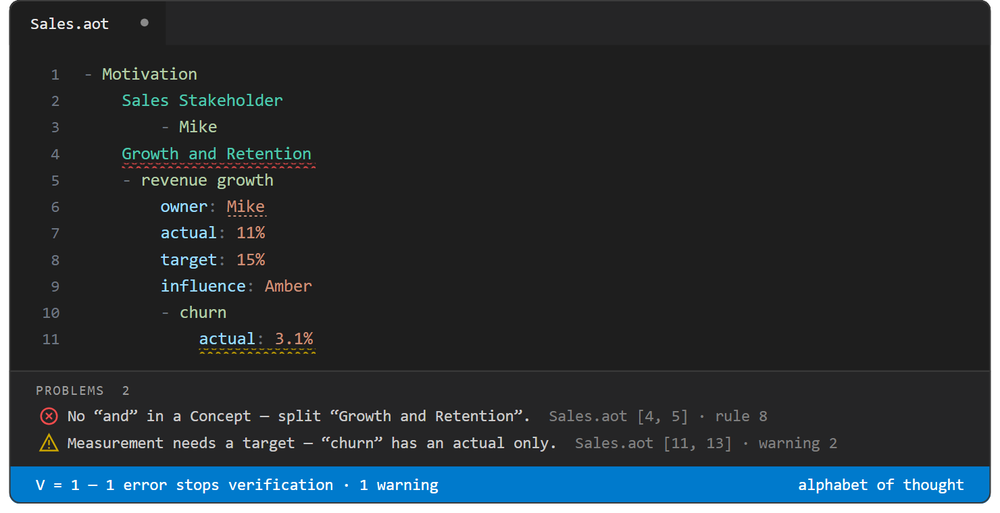

# The checks

[Back to the README](../README.md)

The VS Code extension adds syntax colouring for `.aot` files and an arithmetic linter after Leibniz: every idea receives a prime and its ancestry is encoded as a product, so the linter can verify the tree as you type. Every finding says how to fix it first, then why it is a finding. The checks stack in layers:

- **Syntax and arithmetic** (`src/linter.js`) — tabs, broken indentation, depth jumps, a Concept defined twice, and identical siblings all appear as squiggles in the Problems panel. A finding that names two places — a duplicate, a clash, a case-twin — squiggles **at both**, each diagnostic carrying the other location as clickable related information.
- **Crosslinks** (`src/crosslinks.js`) — an attribute whose trailing words match a Concept, or an Attribute Value that names an Example (case-insensitive, like every link), is underlined as a link; Ctrl+click jumps to the defining line, Shift+F12 lists every place a Concept or Example is referenced, hovering a linked Example shows its full details (owner, defining line, every value it carries), and hovering an Example's own `- ` line adds where it is used. A `https://` URL in a value is Ctrl+clickable too, and hovering it fetches its status, content type, and last-modified date (off with `aot.urlMetadata`). A value that resolves to a **real file** — an absolute path, one relative to the `.aot`, one relative to the workspace root, or a `~/` path from your home directory — is Ctrl+clickable as well, and so is a **`- ` Example whose name is such a path** (an Example may *be* a file, exactly as a table row may). A cited file living outside `aot.files` whose name is also held there clicks and hovers through to the **copy in `aot.files`** — the one that travels with the repo. Hovering an **image** (a `.png` or the like, whether URL, file value, cell, or `- ` Example) previews the picture inline.
- **Rename that keeps the model whole** — F2 on a Concept, an Example, or an attribute (line-form or a table's header or first-column cell) renames it everywhere it is meant: the declaration, every crosslink that resolves to it, and every `@` reference inside a derivation or a constraint's bound — the rename follows the same resolver that hands Python its references, so `@price`, `@total@Acme` and `@Order@price@Acme` all follow their declaration and no derivation is left pointing at yesterday's name. An attribute renames with its whole scope (the same-named copies its host's Examples carry, and the ancestor constraint that governs it); an attribute wearing a renamed Concept's name follows it, and the derivations reading that attribute follow in turn. Case follows the span: a span that is lowercase today (an attribute name, its alias) takes the new name lowercased, every other span takes it as typed — so Concepts stay capitalised and attributes stay lowercase through any rename. A span that resolves by another text — an alias, a plural — keeps its own spelling.
  - **Across the workspace.** A Concept written in another file is renamed there too, and so is every crosslink and `@` reference in another file that resolves to what is renamed, the same Concept's spelling in any file included. Other files are edited and left unsaved, for you to review.
  - **Rename by typing.** Typing over a used name is a rename in progress. Once the cursor leaves the name — or you save, or switch editors — the uses still saying the old name are counted across the workspace, and one notice offers to update them all: *'Socrates' is now 'Sokrates' — 3 uses still say 'Socrates' — 2 here, 1 in bank.aot*, with **Update 3 Uses** and **Dismiss**. It is one edit and one undo. The offer stays on the declaration's lightbulb until taken, dismissed, or moot. When the new name already names another of its kind, the notice says the update would merge the two, and **Dismiss** comes first. Undo and redo never start one.
  - Standing in a used name shows faint ghost text at the end of the line, *2 uses elsewhere*. Standing in a usage (an attribute wearing a Concept's name, a value naming an Example), it names what that usage points at, *names 'Person' — typing changes just this one*, since typing over a usage re-points that one reference rather than renaming anything.
- **Parking the derivations** (`src/park.js`) — `Ctrl+Shift+`` runs every Python derivation fresh, writes the values it computed where they stood, and *then* lifts the derivations out to `aot.files/<file>.formulas`, each addressed with the `@` path the language already uses. The grid narrows to its data; the same key puts them back. The parked file still stands on its own, so nothing else in this list — nor `verify.js` — knows the store exists. The one thing that does is the editor's own marking: a parked value is tinted where it stands and hovers with the derivation that owns it (`aot.parkedValueMarks`), so plain data never reads as data you may retype. See [Parking the derivations](formulas.md#parking-the-derivations).
- **Two names for one idea** (`src/synonyms.js`) — the one half of univocity a linter cannot prove: two *different* names may still be one idea, and nothing in the tree records that `Client` and `Customer` are the same word in two dialects. So it asks, repo-wide and on both sides, with a lightbulb to rename one into the other or to record that they are genuinely different. Advisory, never in `V` (see [Two names for one idea](#two-names-for-one-idea)).
- **Subsumption** (`src/subsumption.js`) — a reasoner re-derives the Concept hierarchy from the facts each Concept declares and holds the written tree to it.
- **Formal Concept Analysis** (`src/fca.js`) — the linter treats the Examples and their attributes as a formal context, computes the concept lattice, and flags groupings the data supports that no Concept names, Examples filed away from the Concept whose attributes they share, and sub-Concepts that fail to cover or distinguish their parent's Examples. The crosslinks deepen the analysis: a value that names an Example elsewhere in the file carries that Example's whole ancestry into the context, so `operation: Ratio` and `operation: Formula` group together when Ratio is filed under Formula.
- **Gödel numbering** (`src/godel.js`) — where a line's characteristic number encodes only *where* it sits, a second Gödel number encodes *what it says* — one prime per attribute, raised to a power that encodes the value — and the linter compares those numbers to catch content clashes, values every child states, defaults no child keeps, and one content under two names across files. The numbers are stable (`aot.files/godel.tsv`), hover shows a node's content, `--diff` recognises renames, and git can merge an `.aot` by meaning (see [Gödel numbering](#gödel-numbering) and [Merging with git](cli.md#merging-with-git)).
- **Dependency inference** (`src/armstrong.js`) — the linter infers the functional dependencies the Examples bear out (see [Armstrong's axioms](#armstrongs-axioms-dependency-inference)).

The extension maps its findings to two severities: **errors** squiggle red and **warnings** squiggle yellow. Only errors count toward the violation total `V`; the file **verifies** when `V = 0`.

**Twenty findings alike are one.** When 20 or more findings in a file share a rule and a fix, as a whole column breaking one bound does, the Problems panel shows the first, its message ending `— and 24 more like it`, with the first ten others under Related. The status bar, `verify.js` and `check.js` keep the true count.

The same referee runs headless: `node verify.js <file.aot>` performs the identical check from the terminal — same rules, same gates, same `V` — and exits `0` exactly when the file verifies, so it drops straight into CI or an agent loop. **`V` is about structure.** A value in front of a formula and a value under a rule are only checked when something calculates them: the editor, or [`node check.js`](cli.md#the-calculating-check). See [The command line](cli.md).

## Errors — red squiggle, counted in `V` (the file does not verify)

| # | Rule | What triggers it |
|---|------|------------------|
| 1 | **No tabs** | A tab character in a line's indentation, or in a name or a value, a table's cells included. Indent with spaces only. A tab in a name or a value shows as blank space, so two that look alike are not, and it splits the value in two wherever a tab divides cells, as in a spreadsheet. The lightbulb replaces it with a space, and offers **Create Table** for tab-separated lines pasted outside a table. A tab inside a formula is the formula's own. |
| 2 | **Indent is a multiple of 4** | Leading spaces not divisible by 4 (`spaces mod 4 ≠ 0`). |
| 3 | **No depth jumps** | A line indented more than one level deeper than the line above it — there is no parent at the skipped depth. |
| 4 | **Well-formed Example** | A line starting with `-` but not `- ` (exactly one space after the dash). |
| 5 | **No empty value** | `name:` with nothing after the colon. Supply a value or drop the colon. |
| 6 | **Do not repeat the file name** | A top-level line whose name equals the file name. The file name is already the root Concept. |
| 7 | **A Map holds only Maps** | A `...` Map node with any non-Map child. A Map marks omitted, todo, or low-confidence information; it never describes its parent and does not contain content. |
| 8 | **No "and" in a Concept** | A Concept name containing the word `and` — that is two kinds under one prime. Split it. |
| 9 | **Univocity** | The same Concept name defined more than once — case-insensitively, and numbering prefixes ignored (`Foo`, `FOO`, and `2. Foo` are one name). Every definition squiggles, each pointing at the others. One name, one prime; a recurrence needs a distinguishing qualifier prefix. |
| 10 | **No identical siblings** | Two children of one parent with the same kind, name, **and** value — compared case-insensitively, as references resolve. Siblings may share a slot only if their values differ. |
| 11 | **One alias, one target** | A Concept's alias must be a genuinely new name: two Concepts sharing an alias, an alias repeating its own Concept's name, or an alias that is the name of **another** Concept (`Home Address (Location)` where `Location` is also a Concept) — the last makes the two a single duplicated identity. If one is a *kind* of the other, file it under it in the tree; otherwise merge or rename. (Attribute aliases like `duration (time)` are unaffected — they are the attribute's crosslink.) |
| 12 | **Well-placed derivations** | A definition on a bare attribute that does not read as Python (`note = some words` — it defines nothing; add the colon to make it the value's own derivation), a derived default (`Currency: EUR =pick()`, or `tax rate: =x` in a header — a default is stated), a Concept's `=` with nothing after it, a lone `=` on a line of its own, or a bound with no attribute in front of it (`==("a", "b")`). What a derivation or a bound *computes* is never the linter's to judge: it is [Python](formulas.md), which runs only when asked, and its findings — a failure, a breached constraint — are in a collection of their own that never counts in `V`. |
| 24 | **A part is not its whole** | A sub-Example carrying the name of an Example it sits under — directly or further up, in `- ` lines or table rows, case and numbering aside. One name cannot be both the whole and its part, and every path that names it (`@Order@total@X@X`, the CSV mirror's `parent` column naming its own row) would say nothing. The error is on the child, pointing at the parent. |
| 25 | **A parent cell names a row** | A table's [`parent (thing)`](tables.md) cell naming no row of its table, naming its own row, or one of a circle of rows each naming the next — a circle has no top, so none of its rows has a place in the tree. Each such row stays a row of the table's own Concept. Also: a second parent column, or one carrying a default or a bound, and a second [`...` column](tables.md). |
| 26 | **A number has one value** | One attribute set to two different numbers on one node: `discount: 10%` and `discount: 15%`. Several texts on one attribute stay allowed (`tag: a`, `tag: b`), and a value with a unit that isn't built in counts as text (`film: 12 Monkeys`). |
| 27 | **A unit can be read** | A unit the repository [writes itself](formulas.md#your-own-units), under a Concept called `Unit`, whose `factor` is no plain number (`1000`, `0.01`, `1,000` and `1/220` are), whose `format` has no `#` for the number, or whose name, or the mark its format writes behind the number, is more than one word. A value's unit is the one word after its number, so `5 FTE day` would read as text. |

Rules 1–12, 24 and 27 are the syntactic and arithmetic checks (`src/linter.js`). On top of them, a **subsumption reasoner** (`src/subsumption.js`, after Description Logics' EL) re-derives the Concept hierarchy a *second* time — not from where each line is written, but from the facts each Concept declares (its attributes, values, the Concepts it crosslinks to, and any value's inherited ancestry) — and holds the written tree to it. A Concept's definition is read as a conjunction of those facts; `C is-a D` holds when D's whole definition is satisfied by C. A `...` Map child marks a Concept *open* (its facts are necessary but not yet sufficient), which excuses it from these checks. Placements the derived order contradicts are errors, also counted in `V`:

| # | Rule | What triggers it |
|---|------|------------------|
| 13 | **Misfiling** | A Concept's one most-specific genus (the Concept whose full definition it satisfies) is filed somewhere other than where this Concept sits — its facts say it is a kind of a Concept it is not written under. |
| 14 | **Multiple kinds** | A Concept's facts satisfy two genera, neither of which is under the other. A Concept must name one kind; file it under one and crosslink the other, or split it. This is the real single-inheritance check. |
| 15 | **Equivalence** | Two Concepts, neither above the other, carry identical definitions — their facts cannot tell the two kinds apart. Give one a differentia, or merge them. |
| 16 | **Cycle** | A loop of mutual is-a in the derived order (`A is-a B is-a … is-a A`), which no hierarchy can hold. Break it by giving one member a differentia the others lack. |

A genus must rest on at least two declared attribute names — one shared word is coincidence, not a kind.

On top of rules 1–16, a third tier of errors comes from the **Formal Concept Analysis audit** (`src/fca.js`) and the **Gödel numbering** (`src/godel.js`). A lattice or a content comparison over a broken tree means nothing, so these run **only once rules 1–16 are clean**, and the FCA rules need at least 2 Examples. They run on a file of any length: their cost grows with the rows, so a 50,000-row table is read in about a second and a half. (Before 1.15 they stopped at 200 Examples, to spare a lattice the findings never read; only `verify.js --suggest` builds that lattice now.) When they fire they are violations counted in `V` — the file does not verify until they are resolved:

| # | Rule | What triggers it |
|---|------|------------------|
| 17 | **Drift** | An Example carries every attribute the Examples of some Concept share, yet is filed elsewhere. Move it under that Concept, or give the Concept a differentia that genuinely excludes it. |
| 18 | **Exhaustion (overlap)** | Two sibling sub-Concepts read as different kinds but their Examples carry identical attributes. Differentiate them, or merge them. |
| 19 | **Exhaustion (gaps)** | Some of a parent's Examples match none of its sub-Concepts by attributes. The division misses a kind, or the Example lacks the attributes of its kind. |
| 20 | **Clash** | Two unrelated Concepts with equal Gödel numbers — identical attributes *and* values — so the data cannot tell them apart; or two Examples that share their **name** as well. An Example's name is part of what it is, so `P1` and `P2` carrying the same amount to the same payee are two payments, never a clash. Give one a differentia, or merge them. (The weaker same-name case — equal radicals, differing values — is not itself a violation.) |

A `...` Map child marks a node intentionally incomplete and excuses it from the drift and exhaustion checks (its missing siblings or attributes are declared, not forgotten) — for drift on **either side** since 1.8: no drift toward an open Concept, and none away from an open home, whether the marker is a Map or the Example form `- ...`. Drift needs **both sides of the fence to assert something explicitly** — inherited attributes never count. A Concept whose Examples share nothing beyond their ancestor's is skipped as a target, as is a Concept whose whole shared intent is inherited from above; and since 1.6 the Concept the Example is filed **under** must own at least one explicit attribute too (declared on it or beneath it) — a home that declares nothing states no differentia to hold or release an Example by, so no drift is reported from it.

One more error comes from the **declared dependency graph** (`src/armstrong.js` — see [Armstrong's axioms](#armstrongs-axioms-dependency-inference)). It is structural: it needs no Examples, reads the current file only (like the subsumption pass), and is **not** gated behind rules 1–16 — a loop shows in the same pass as any other error:

| # | Rule | What triggers it |
|---|------|------------------|
| 21 | **Dependency cycle** | A Concept rests on itself through other Concepts — `Shares Outstanding ─tensor→ Tensor ─shares outstanding→ Shares Outstanding`. A dependency chain must ground out, and a loop derives only `X → X` (Reflexivity, trivially true), so it asserts nothing while leaving every member defined through the others. One error per attribute carrying an edge of the loop — removing any one breaks it. An attribute of a Concept's **own** kind (`parent measurement` on `Measurement`) is direct self-reference: legitimate recursion, never flagged. |

Two more come from the **repo** (`src/repo.js` — see [Concepts across files](language.md#concepts-across-files)). They apply only when the caller supplies the rest of the workspace, so a file judged on its own never sees them, and they are the only two disagreements a save does not simply close:

| # | Rule | What triggers it |
|---|------|------------------|
| 22 | **Contradicted value** | The same Concept, written in two files, carries two values for one attribute — `Jakus` with `role: analyst` here and `role: bookkeeper` there — or the same Example of it does, in lines or in a table: `Acme` with `discount: 10%` here and `15%` there. One name means one thing, so it cannot mean both. Reported on every side, at the line that disagrees, each pointing at the others. One side saying nothing about the attribute is **not** this rule — silence is filled in on save, not flagged. |
| 23 | **Contradicted kind** | The same Concept filed under two different kinds — `Jakus` under `Motivation` here and `Team` there. A Concept is one kind. Only the *nearest* named ancestor is compared (how deeply each file nests its own subject is its own business), and a Concept at the top of one file contradicts nothing: that is silence again, not a second kind. |

## Warnings — yellow squiggle, in the Problems panel, but not counted in `V`

| # | Rule | What triggers it |
|---|------|------------------|
| 1 | **Singular Concepts** | A Concept name whose last word is plural (checked with `pluralize`, so it catches irregulars too: `Humans`, `Categories`, `People`). Use the singular form. |
| 2 | **Measurement needs a target** | A node with an `actual:` value but no `target:`. |
| 3 | **Measurement needs an actual** | A node with a `target:` value but no `actual:`. |
| 4 | **At most eight sub-Concepts** | More than eight sub-Concepts under one node. Group some under an intermediate kind. (Examples and attributes may be any quantity.) |
| 5 | **No lone sub-Concept** | A Concept with exactly one sub-Concept — a kind with one subtype *is* that subtype. Have zero, or more than one. Excused when another file's copy of the Concept writes a different subtype, since together they divide it (in the editor and `check.js`; `verify.js` on one file sees no other), and for `Unit`, whose other kinds are [built in](formulas.md#your-own-units). When you type a Concept's first subtype, the editor adds a `...` under the Concept once the cursor leaves it, saying more kinds are to come, so this warning doesn't show while you write. That `...` stays until you delete it, and while it stands it excuses the Concept from warnings 4–7. |
| 6 | **No lone sub-Example** | An Example with exactly one sub-Example, by the same reasoning. |
| 7 | **Differentia** | Two or more sibling sub-Concepts with an identical attribute/value *slot signature* — they are told apart by position only. Give each a distinguishing attribute or value. A sub-Concept that asserts no slot at all is excused: with no attributes its `...` is implied, so its differentia is still to come. |
| 8 | **Case-twin Examples** | Two Examples whose names differ only in case (`- Socrates` / `- socrates`). Example references resolve case-insensitively, so they are one name to every link and audit — align the spelling. |
| 9 | **Stale derivation** | *No longer the linter's.* A formula edited since it last calculated, or reading something that changed, has its value faded until the file calculates, which in automatic calculation is as soon as you leave the cell — see [Running](formulas.md#running). With formulas off or in manual calculation it also says so, as information. |
| 10 | **Breached constraint** | *Found when the file calculates.* A value that fails its attribute's constraint (`age: 15` under `age >=18`, `status: void` under `status =("draft", "sent", "paid")`) is a warning under the source `formula`, pinned to the offending value, naming the bound — worth knowing, but data out of bounds is not a broken file, so it never counts in `V`. It stands until the value is edited or the next calculation. See [Constraints](formulas.md#constraints). |
| 11 | **Redundant dependency** | A direct dependency edge that a chain through another Concept already implies (Armstrong Transitivity): `share` on `Shares Outstanding` when `Shares Outstanding ─tensor→ Tensor ─share→ Share` already holds. The declaration adds nothing — drop the direct slot, or drop an intermediate link if the direct dependency is the one meant. Two attributes of the same type (`from node` / `to node`, both a `Node`) never imply each other: the witnessing chain must pass through an intermediate Concept. |
| 15 | **State a fact once** | Every child of a node sets one attribute to one value for itself — `wheels: 4` under both `Car` and `Van` — so it is a fact about the parent written once per child. The lightbulb **moves it up**: written once under the parent, taken off every child; a table column holding it in every row is dropped, and the fact stands [under the table](tables.md). Needs two children that are kinds, or three that are Examples (two rows agreeing is as often chance), and no `...` Map (an open division may yet gain a child that differs). A derived value is its own row's, never lifted. |
| 16 | **A default nothing keeps** | A node sets `temperature: cold` and every child overrides it — the default is in force for nothing under it. The lightbulb keeps just the attribute; when the children agree on one value instead, rule 15 offers to write that one in its place. |
| 18 | **Identical Examples** | Two or more sibling Examples, rows or `- ` lines, whose own values all say the same: at least three values, every one equal, and at least one of them uncommon in its column, held by no more rows than the square root of their number, or by two. Nothing written tells them apart, so one is likely a duplicate, as a payment entered twice is. Blank cells, inherited values, formula results, a column a definition fills, and the `parent` and `...` columns don't count, so a computed column adds no evidence. The uncommon value is what keeps chance matches out: three yes/no columns over 20 rows would otherwise flag some two dozen pairs. A `...` on either Example, or under their parent, says they differ in something the file doesn't say, and excuses them; the lightbulb writes it. Not the clash (rule 20): their names differ. Runs on a file of any length, hashing each row once. |

Rules 15 and 16 are Gödel arithmetic (`godel.hoists`: every child's valuation of one prime equal, and the parent's not), so like the clash they run only once rules 1–16 are clean.

A `...` Map child marks a node intentionally incomplete, which **excuses** warnings 4–7 for that node: the missing siblings or differentiae are declared, not forgotten. A Map says *what is still missing, a todo, or uncertain* — it is never a description of the line above it (use a parenthetical alias to name or explain a term).

Two more warnings come from the dependency inference in `src/armstrong.js`. They are **off by default** — correlated attributes are allowed; opt in with the `aot.dependencyFindings` setting (`node verify.js --fd` always prints the full set). Like the FCA audit they mean nothing over a broken tree, so they run **only once rules 1–16 are clean** and need **between 2 and 5,000 Examples** in the file, since they compare the rows' values pairwise; past 5,000 a warning on the first line says they stopped, and how to bring them back. They reuse the Gödel numbers. They are warnings, not errors — a derivable column is a modelling smell, not a contradiction — so they do **not** count toward `V`:

| # | Rule | What triggers it |
|---|------|------------------|
| 12 | **Dependency (equivalence)** | Two attributes determine each other across the Examples — the same distinction written twice. Confirmed only when a value actually **repeats** (two Examples share it and still agree), so the collapse is witnessed, not coincidence. Model one and derive the other. |
| 13 | **Dependency (determination)** | One attribute's value is always pinned down by another across the Examples — a derivable column. Model it once, against its determinant. |

Each finding carries a **confidence**: the number of *confirming repeats* (Examples beyond the first that share a value and still agree). A pure one-to-one **covariation** — every Example distinct on both sides, so no value ever repeats — has confidence 0: the attributes track each other but no collapse is witnessed, so it could be coincidence. The editor (when `aot.dependencyFindings` is on) flags only findings at or above `MIN_CONFIDENCE` (2) — a single confirming repeat is not enough, so a 3-Example case never squiggles; weaker and covariation-only pairs stay off the squiggle channel. An ellipsis marker among the Examples — a `...` Map or a `- ...` Example — declares the sample intentionally incomplete (the same marker that excuses warnings 4–7), so any dependency read off those Examples is **provisional**: it is never flagged, however high its confidence, since more data is openly still to come.

### Two names for one idea

One name, one meaning is the first rule, and the linter proves the half that can be proved: the *same* name written twice must mean the same thing. The other half is not provable at all — two *different* names may still be one idea, and no arithmetic over the tree will ever say so, because nothing in the tree records that `Client` and `Customer` are the same word in two dialects. That is a fact about English, not about the model.

So the check does the only honest thing available offline: it recognises the collisions that actually happen when people model, and it **asks**. It is repo-wide — `Client` here and `Customer` in the file next door is exactly the pair worth catching — and it reports on **both** sides, each carrying a Ctrl+clickable link to the other.

| # | Rule | What triggers it |
|---|------|------------------|
| 14 | **Two names for one idea** | Two Concepts whose names match word for word once each word is mapped to its synonym group (`Sales Client` / `Sales Customer`, `Fix Defect` / `Repair Bug`), or once each word is cut to a shared prefix of six characters or more (`Governance` / `Government`, `Reconciled Item` / `Reconciliation Item`). |
| 17 | **One content, two names** | Two Concepts in **different files** carrying exactly the same attributes and values (equal [Gödel numbers](#gödel-numbering), numbered as one over the repository) under names that share nothing — `Kettle` here, `Boiler` there. Within one file this is the content clash, an error (rule 20); across files it is a warning, since one file may still be writing its differentia. Asked only of a file that is itself clean, and only in a workspace. |

Three things end the question, and each is a decision only you can make:

- **Rename one to the other** — the lightbulb's first, preferred fix. It goes through the rename engine, so every reference follows exactly as `F2` would move them.
- **Write the alias**: `Human (Natural Person)` *declares* that the two names are one idea, which is the supported way to say what the check is asking about. A pair where one is the other's alias is never raised.
- **Say they are different**: the second lightbulb records the pair in `aot.distinctConcepts` and never asks again, in either order and in any file.

The same two lightbulbs — rename one to the other, or keep them apart — answer rule 17, the same content under two names in two files, which asks the same question from the other side.

It is advisory and never counted in `V` — a naming collision is a question, not a contradiction — and it is off entirely with `aot.synonymWarnings`. The vocabulary (`src/synonyms.js`) is deliberately small and domain-shaped rather than a thesaurus: a general thesaurus makes near-synonyms of words a model needs to keep apart (`cost` and `price`, `target` and `goal`), and every false finding spends the reader's attention. Names that differ only in **number** (`Person` / `People`) are left to the singular-Concept warning above, and names that differ only in **case** are univocity's business.

**Findings elsewhere wait while you write.** Typing a child sets off findings that are not about the line being typed. The parent has "1 sub-Concept" the instant its first child exists. A sibling now overlaps, an ancestor reads as misfiled, a name elsewhere has a duplicate. Most of these are gone a line later, and flashing them mid-thought only interrupts. So, from the first edit of a burst:
- A finding already on screen when you began keeps showing, so nothing flickers.
- One that goes away goes at once, so a fix shows.
- One on a line you edited shows at the usual debounce: your own lines speak.
- Every other new finding **waits**.

The wait ends, and what waited shows, when:
- the cursor leaves the **family** of what you edited: the edited node's parent and everything under it, the parent's own line aside, so typing three siblings in a row keeps the parent quiet; at the top of the file, the edited node's own subtree;
- you save;
- another editor takes over.

There is no timer: you say you are done by moving on. Nothing is hidden silently. While findings wait, the status bar says `$(clock) 2 waiting — leave 'Parent' to see them`, its tooltip lists them, and a click shows them now. `verify.js` is unaffected: on the command line every finding is always reported.

Earlier versions surfaced three advisory hint kinds with no squiggle: the FCA audit (after Wille, 1982), the content clash, and the dependency inference. The FCA audit and the content clash are now **errors** counted in `V` (rules 17–20); the dependencies are now opt-in **warnings** (rules 12–13). Spelling is the one finding that maps to the editor's Hint severity.

## Gödel numbering

The characteristic number `chi = prime × chi(parent)` is a squarefree product: it records a line's **ancestry** — *where* it sits — and nothing else. The Gödel number `G` is its complement, after Gödel (1931): it records a line's **content** — *what it says* — by raising **primes to powers**. Each attribute gets one prime; the exponent encodes the value that attribute is set to:

- exponent **0** — the attribute is absent (its prime does not divide `G`)
- exponent **1** — the attribute is present but unvalued
- exponent **k > 1** — the attribute carries a value, `k` a stable code for it

So a line that sets three attributes becomes one integer like `2³ × 3⁵ × 5²`. The two numbers cover both axes of a line — `chi` the *where*, `G` the *what*. Every question a model asks of its content is then plain arithmetic on `G`: whether idea *n* carries attribute *a* (`prime(a)` divides `G(n)`), whether two ideas carry the same attributes (equal radicals) or identical content (equal `G`), what value an attribute takes on a line (the exponent of its prime, decoded), which ideas override an inherited default (a prime dividing both `G(n)` and `G(ancestor)` with unequal exponents ≥ 2), and which attributes are present but not yet valued (primes with exponent exactly 1).

The linter puts this to work in the lint pass: two ideas with identical attributes *and* values (equal `G`) are a content **clash**, an **error** counted in `V` (rule 20) — two Concepts whatever they are called, since a kind *is* its definition, but two Examples only when they share their name too, since an individual is told apart by what it is called before anything it carries (case and a numbering prefix aside, as everywhere). Like the FCA findings, it is meaningless over a tree that does not yet verify, so it runs only once the syntactic and subsumption passes are clean — but when it fires, it is a violation, not an advisory. Three warnings read the same arithmetic: a value **every child states** belongs on the parent (15), a default **every child overrides** is in force for nothing (16), and the same content under **two names in two files** is one idea twice (17).

**The numbers are stable.** Primes and value codes are handed out once and kept in `aot.files/godel.tsv` — `a⇥legs⇥2` gives an attribute its prime, `v⇥legs⇥3⇥4` a value its code — and a save adds what is new without renumbering anything (`aot.godelRegistry`). So the number you read today is the one you read after an unrelated attribute is added, and one attribute has one prime in every file and on every branch, which is what lets two files, or two sides of a merge, be compared at all. No file stores `G` itself, so the registry is safe to delete: it is rebuilt with new numbers. It merges with git's union driver, and a merge's duplicate claims are settled when it is read — a prime claimed twice goes to the name that sorts first, conflict markers are skipped. `node verify.js --workspace [dir] --primes` writes it from the command line.

**Hover shows it.** Hovering a Concept's or an Example's name adds its **content**: `G` as a factorisation (`G = 2 · 13² · 19⁴`; the integer itself while it has thirty digits or fewer, past that its size, `≈ 4.12 × 10^1,234 (1,235 digits)`), one line per attribute with where an inherited one came from (`` `legs`: `4` — from 'Pet' (line 2) ``), what it overrides, and the **nearest sibling** of its kind with how the two differ — or *identical in content to …*, which is the clash seen from the inside.

**How the numbers are computed.** By the fundamental theorem of arithmetic, a positive integer *is* its factorisation, so `G` is kept as its exponent vector — the primes a node carries and their exponents — and never built as an integer unless one is shown. Every question above becomes arithmetic on a handful of exponents: equality a comparison of keys, divisibility and gcd a merge walk, a value an exponent looked up, the size a sum of logarithms. Nothing in the editor waits on how large an integer is: on a 2,000-row table a hover went from 6.7 s to 0.6 ms and rules 15–16 from 3.5 s to 7 ms. The primes come from a cached sieve. [docs/godel-numbers.md](godel-numbers.md) has the method, the measurements, and the alternatives turned down.

## Armstrong's axioms (dependency inference)

A functional dependency `X → Y` says "fix `X` and `Y` is fixed too". Armstrong's axioms are the inference rules for such dependencies, and `src/armstrong.js` makes them part of the linter in two ways, both reusing the Gödel numbers above.

The six axioms, and what the linter does with each. **Reflexivity** (`Y ⊆ X ⊢ X → Y`) makes every `X → X` trivially true — a self-edge asserts nothing, so the graph drops it, and an attribute of a Concept's own kind stays legitimate recursion, never flagged. **Transitivity** (`X → Y, Y → Z ⊢ X → Z`) is the working axiom: it builds the closure behind `--depends`, the hover and the inlay chains; a chain that leads back to its start is a **dependency cycle** (error rule 21); a direct edge that a chain through another Concept already implies is a **redundant dependency** (warning rule 11); and over the inferred set it prunes the implied statements to a minimal cover. **Augmentation** (`X → Y ⊢ XZ → YZ`), **Union**, **Decomposition** and **Pseudotransitivity** speak of *sets* of attributes on a side; the dependencies here are single-attribute edges, so Augmentation and Pseudotransitivity have nothing to attach to, Union never arises, and Decomposition holds by construction — every right side is already atomic.

**Inferred from the Examples.** Project every Example's `G` onto an attribute's prime — its value code — and group the Examples by it. `X → Y` holds when `Y`'s code is constant within every `X`-group, across enough Examples to be more than coincidence. A column thus determined by another is **derivable**: model it once rather than restating it on every Example (the normalisation reasoning the Graph rationale is about). When the dependency runs both ways (`X ↔ Y`), the two attributes are the same distinction written twice. An antecedent that is distinct on every Example (a key) is ignored — it determines everything vacuously, with no evidence — unless its partner is a key too, a genuine bijection. The set is pruned to a **minimal cover**: an `X → Z` that `X → Y` and `Y → Z` already give follows by Transitivity, so it is held off the squiggle channel — `--fd` still prints it, tagged `[implied by 'x' → 'y' → 'z']` — and a member of an equivalence is never pruned. The strongest of the rest surface as opt-in warnings (rules 12–13 above; off by default via `aot.dependencyFindings`, never counted toward `V`).

**Declared by the crosslinks.** A dependency is a Concept resting on another through an **attribute** — an attribute whose name ends in a Concept, or a **value that names another Concept's Example** (`person: Socrates` with Socrates under `Human`; the value edge matters, or linking through a value would hide the dependency it creates). A Concept that merely *contains* another in its name (`Recurring Tree`), or is *aliased* to one, is a **kind** of that Concept, not a dependency on it — those crosslinks still navigate, but they are not dependency edges. The transitive closure (Armstrong transitivity) gives what a Concept rests on directly and what it inherits through a chain — `node verify.js <file> --depends "X"` prints both, each transitive dependency with one witnessing path. In the editor the chains are visible twice over: **hovering** a Concept (or any crosslink) lists every chain in full (`Trip ─driver person→ Person ─home address→ Address — 3 Concepts`), and an **inlay hint** writes the first chain in small print at the end of each **attribute** crosslink's line (`→Person→Address`, off with `aot.chainHints`) — only an attribute typed by a Concept *depends* on it, so a Concept that merely contains or aliases another carries no arrow. The same graph is held to the axioms in the lint pass, current file only: a chain leading back to its start is a **dependency cycle** (error rule 21, counted in `V`, one error on each attribute carrying the loop), and a direct edge a chain through another Concept already implies is a **redundant dependency** (warning rule 11, on the declaring attribute).

**Across files.** Every `.aot` in the workspace is indexed, so all of the above resolves repo-wide, and a Concept written in two files is held to [one meaning](language.md#concepts-across-files). Most of what used to be reported is now simply closed on save — an attribute one file declares is written into the other, and the `...` line saying where the rest of the Examples live is kept true — so only the two decisions a tool may not take for you reach the Problems panel, as **errors counted in `V`**, on every file involved and with each other's lines as clickable related locations:

- **one attribute carrying two values** (rule 22) — the lightbulb offers *Set '`attr`' to '`value`' everywhere*, which rewrites every file at once;
- **one Concept filed under two kinds** (rule 23) — the lightbulb offers the rename, for when two different ideas merely collided on a word.

`V` is therefore the file's violations *given the repo it sits in*: a repo-wide error is always reported on both sides, at the lines that disagree, never inferred from a file you cannot see. A file linted on its own — a lone file outside a workspace, or `lint(text, rootName)` with no repo argument — is judged entirely on its own terms, exactly as before. Every open `.aot` re-analyses when the index changes, so resolving a disagreement clears it live on both sides. `node verify.js --workspace [dir]` reports the same from the terminal and exits `1` on a contradiction; `--reconcile` writes the agreement in first.
